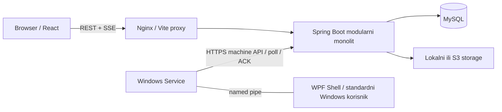

# G-Manager

G-Manager je sistem za upravljanje igraonicom i povezanim poslovnim procesima: korisnicima, proizvodima i uslugama, rezervacijama, fizičkim resursima, narudžbinama i radom gaming stanica. Web aplikacija služi kupcima i osoblju, dok Windows Client povezuje jednu stanicu sa backendom i sprovodi potpisanu politiku aplikacija i vremenski ograničene gaming sesije.

README i [tehnička dokumentacija](docs/README.md) opisuju statički pregled implementacije od **1. novembra 2026.** Prisustvo koda i testova ne potvrđuje uspešan produkcioni ili fizički Windows rollout. Poznata ograničenja su u [izveštaju pregleda](docs/MAINTENANCE_AUDIT.md).

## Implementirane funkcionalnosti

Gaming naplata koristi trajno vreme u sekundama i cenu po minutu koju podešava OWNER/ADMIN: [tok rada, API i migracija](docs/GAMING_TIME.md).

`TIME_BALANCE` je jedini aktivni gaming režim. Dopune se ručno evidentiraju kao gotovina ili spoljni POS; tarife, novčani wallet i paketi nisu dostupni. V51 izdvaja stare podatke u istorijsku arhivu: [opis izmene i postupak nadogradnje](docs/operations/GAMING_BILLING_RETIREMENT.md). Izmena je pripremljena bez izvršavanja migracije, testova ili build-a.

- Uloge `OWNER`, `ADMIN`, `EMPLOYEE` i `CUSTOMER`, permission i resource scope provere, profil, upravljanje web sesijama, rotacija refresh tokena i audit.
- Kreiranje kupaca od strane osoblja i jednokratna aktivacija. Javna registracija je isključena.
- Katalog proizvoda i usluga sa slikama, cenama i trajanjem; radno vreme, izuzeci, odsustva zaposlenih i dostupni termini.
- Rezervacije, kalendar, ponavljajuće rezervacije, waitlist i provera preklapanja; lokacije, zone, fizički resursi, mapa i dodele zaposlenih.
- Korpa i pickup narudžbine, dashboard, pretraga, saved views, notifikacije i CRM beleške/tagovi.
- Asinhroni CSV/XLSX/PDF izveštaji, rasporedi i šabloni; document infrastruktura sa lokalnim ili S3 skladištem.
- Gaming operativa: ručna dopuna trajnog vremena, dodela računara, potvrđena prijava, završetak i istek sesije; heartbeat, durable komande, machine enrollment, potpisani policy/lease i lock reconciliation.
- Windows Service i WPF Shell, development režim, potpisani instalacioni paket, maintenance, update/rollback i recovery alati.
- Ograničen PWA offline pregled i lokalni draftovi; feature flags i opcion, podrazumevano isključen AI sažetak metapodataka izveštaja.

Email adapter je sandbox. Samostalna Documents stranica, approval workflow i produkciona multi-tenancy izolacija nisu dostupne funkcionalnosti. Detalji su u [arhitekturi](docs/architecture/OVERVIEW.md).

## Tehnologije i arhitektura

| Komponenta | Tehnologije iz repozitorijuma |
| --- | --- |
| Backend | Java 21, Spring Boot 4.1.2, Spring Security, JPA/Hibernate, Flyway, Maven Wrapper, OpenAPI, Actuator/Micrometer |
| Frontend | React 19, TypeScript 6, Vite 8, React Router, TanStack Query, Zustand, React Hook Form/Zod, Recharts |
| Podaci | MySQL 8.4, lokalno/S3 document storage; H2 za brze testove |
| Windows Client | .NET 10, Windows Service, WPF, DPAPI, named pipes, Ed25519, AppLocker integracija |
| Isporuka i provere | Docker Compose, Nginx, GitHub Actions, JUnit/ArchUnit/Testcontainers, Vitest, Playwright, Prometheus/Grafana |



Backend je jedan deployable modularni monolit. Outbox i background jobs koriste bazu; poseban message broker nije potreban.

## Preduslovi

- Git, JDK **21** i Node.js koji zadovoljava `^22.13.0 || >=24`. CI i frontend image koriste **Node 22.23.3** i **npm 11.19.1**.
- MySQL 8.4 ili Docker Engine/Desktop sa Compose v2 za lokalni MySQL. Instalirani Maven nije potreban.
- Za Windows Client razvoj: Windows i .NET SDK prema [client/global.json](client/global.json): 10.0.100 uz `latestFeature` roll-forward. Produkciona stanica ima dodatne preduslove iz [Client vodiča](docs/operations/WINDOWS_CLIENT.md).

## Quick Start: backend i frontend na hostu

Komande su za PowerShell i izvršavaju se iz korena checkout-a. Ovo je development konfiguracija. Root `.env` se ne verzioniše; sve vrednosti između `<...>` zamenite sopstvenim lokalnim vrednostima.

1. Napravite root `.env` sa sledećim sadržajem:

   ```dotenv
   DB_URL=jdbc:mysql://localhost:3307/gmanager?useSSL=false&serverTimezone=UTC&allowPublicKeyRetrieval=true
   DB_USERNAME=root
   DB_PASSWORD=<lokalna-DB-tajna>
   JWT_SECRET=<nasumicna-vrednost-od-najmanje-32-ASCII-znaka>
   INITIAL_OWNER_EMAIL=owner@example.com
   INITIAL_OWNER_PASSWORD=<sopstvena-bootstrap-lozinka-najmanje-8-znakova>
   INITIAL_OWNER_NAME=Development Owner
   ```

   `root` je izbor za lokalni Compose koji kreira samo root DB nalog. Host port je **3307**, a backendov ugrađeni default **3306**, pa je `DB_URL` eksplicitno postavljen. Produkcija koristi zaseban aplikacioni nalog.

2. Pokrenite samo bazu:

   ```powershell
   docker compose up -d mysql
   ```

3. U prvom terminalu pokrenite backend. Podrazumevani profil `local` uvozi root `.env` i izvršava Flyway migracije:

   ```powershell
   Set-Location gm
   .\mvnw.cmd spring-boot:run
   ```

4. U drugom terminalu, iz korena repozitorijuma:

   ```powershell
   Set-Location frontend/g-manager
   npm install --global npm@11.19.1
   npm ci
   npm run dev
   ```

Otvorite **http://localhost:5173** i prijavite se sopstvenim bootstrap nalogom. Backend je na **http://localhost:8080**, readiness na **http://localhost:8080/actuator/health/readiness**, lokalni Swagger UI na **http://localhost:8080/swagger-ui/index.html**. Vite prosleđuje `/api` i `/media` backendu.

Za Bash koristite `cd gm` i `./mvnw spring-boot:run`; frontend i Compose komande su iste. Bez Docker-a koristite postojeći MySQL i prilagodite DB promenljive. [Lokalni razvoj](docs/development/LOCAL_SETUP.md) objašnjava inicijalne podatke i rad sa Client-om.

## Ceo lokalni sistem u Docker-u

Root Compose pokreće MySQL, backend i Nginx frontend. Potreban je i **lokalni Ed25519 private-key fajl koji nije deo checkout-a**. Prvo pripremite [lokalni signing ključ](docs/development/LOCAL_SETUP.md#lokalni-policy-signing-ključ), pa iz korena:

```powershell
docker compose up --build -d
docker compose ps
docker compose logs -f backend
```

Frontend je na portu 5173, backend na 8080, MySQL na 3307. Lokalni Compose koristi Spring profil `local`; nije produkcioni deployment. `docker compose down` čuva named volume-e. Opcija `-v` briše podatke i nije deo redovnog zaustavljanja.

## Konfiguracija i struktura

Root `.env` koristi lokalni Spring profil i Compose interpolacija. Frontend ima zaseban [`.env.example`](frontend/g-manager/.env.example) sa `VITE_API_URL=/api/v1`; Vite vrednosti ulaze u frontend pri build-u i nisu mesto za tajne. Produkcioni profil ne uvozi `.env`, zahteva HTTPS origin i release metadata, koristi secure cookies i odvojene migracije. Pogledajte [konfiguraciju](docs/reference/CONFIGURATION.md) i [deployment](docs/operations/DEPLOYMENT.md).

| Putanja | Sadržaj |
| --- | --- |
| `gm/` | Backend, Maven Wrapper, profili, Flyway migracije i Java testovi |
| `frontend/g-manager/` | React, API klijenti, komponentni/PWA/browser testovi, Dockerfile i Nginx |
| `client/` | .NET solution, Service/Shell/Protocol/Domain i Windows packaging skripte |
| `docs/` | Aktuelni vodiči, ugovori, ADR i istorijska arhiva |
| `ops/` | Produkcioni Compose, deploy/rollback, backup/restore, monitoring i machine API provere |
| `scripts/` | Verifikacija, CI pomoćne skripte, development seed i SARIF provera |
| `performance/` | k6 scenario i performance/bundle budžeti |
| `.github/workflows/` | CI i release workflow definicije |

## Dalja dokumentacija

- [Korisnička uputstva](docs/user-guides/README.md): [vlasnik](docs/user-guides/OWNER.md), [administrator](docs/user-guides/ADMIN.md), [zaposleni](docs/user-guides/EMPLOYEE.md), [kupac](docs/user-guides/CUSTOMER.md) i [FAQ](docs/user-guides/FAQ.md).
- [Indeks i redosled čitanja](docs/README.md)
- [Arhitektura](docs/architecture/OVERVIEW.md) · [granice modula](docs/architecture/MODULE_BOUNDARIES.md)
- [Lokalno okruženje](docs/development/LOCAL_SETUP.md) · [seed](docs/DEVELOPMENT_SEED.md)
- [Konfiguracija](docs/reference/CONFIGURATION.md) · [API](docs/reference/API.md) · [uloge i bezbednost](docs/reference/SECURITY_ACCESS.md) · [baza](docs/reference/DATABASE.md)
- [Produkcija](docs/operations/DEPLOYMENT.md) · [Windows Client](docs/operations/WINDOWS_CLIENT.md) · [backup/recovery](docs/operations/BACKUP_RECOVERY.md)
- [Testiranje](docs/development/TESTING.md) · [troubleshooting](docs/operations/TROUBLESHOOTING.md) · [nepotvrđeno i nedostaci](docs/MAINTENANCE_AUDIT.md)
