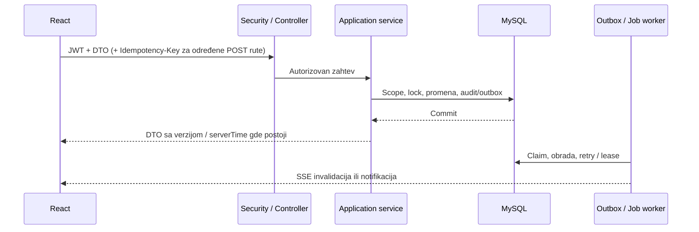

# Arhitektura i komunikacija

G-Manager ima jedan Spring Boot backend, React SPA, MySQL bazu i odvojeni Windows Client. Backend je modularni monolit organizovan po poslovnim paketima. Nema obavezne Redis instance, message broker-a ili zasebnog servisa za svaki modul.

## Komponente

| Komponenta | Odgovornost i izvori |
| --- | --- |
| React SPA | Rute i capability guards u [App.tsx](../../frontend/g-manager/src/App.tsx); transport/refresh u [api/client.ts](../../frontend/g-manager/src/api/client.ts); TanStack Query za serverske podatke, Zustand za auth/feature stanje |
| Spring Boot | Kontroleri primaju DTO, servisi obavljaju autorizaciju i transakcije, repository/JPA sloj radi sa bazom; [SecurityConfig](../../gm/src/main/java/com/game_manager/gm/bootstrap/SecurityConfig.java) je composition root zaštite |
| MySQL / Flyway | Poslovni agregati, idempotency, refresh sesije, audit, outbox, background jobs, station komande i machine identiteti |
| Storage | Slike i document objekti; `UPLOAD_ROOT` za lokalno skladište, S3 adapter za dokumente; metapodaci/checksum su u bazi |
| Windows Service | Machine identitet, sinhronizacija, verifikacija potpisanih lease/policy poruka, IPC i Windows enforcement |
| WPF Shell | Login i gaming dashboard pod standardnim Windows nalogom; pokretanje aplikacija u njegovoj sesiji |
| Nginx / edge | Nginx služi SPA i prosleđuje API/media; produkcioni TLS terminator je spoljašnji preduslov |

## Poslovni moduli

- `auth`, `user`, `customer`, `security`: identitet, web sesije, osoblje, aktivacija kupaca i permissions.
- `catalog`, `workinghours`, `timeoff`, `availability`, `reservation`, `resource`, `waitlist`: usluge/proizvodi, raspoloživost, termini, lokacije/zone/resursi, employee dodele, recurrence i waitlist ponude.
- `order`, `dashboard`, `search`, `savedview`, `audit`: pickup narudžbine, projekcije, pretraga i istorija.
- `gamingsession`, `station`, `machine`: runtime sesije, application profili, distribucija Client-a, machine trust i lock recovery.
- `events`, `jobs`, `notification`, `document`, `report`: durable obrada, in-app/SSE poruke, storage i izveštaji.
- `feature`, `ai`, `extension`: feature overrides, opcion sažetak metapodataka i compile-time extension contracts.

[Granice modula](MODULE_BOUNDARIES.md) i ADR objašnjavaju zavisnosti i portove. Ne postoji `MANAGER` role enum; naziv radnog mesta ne uvodi novu rolu.

## Web zahtev i transakcija

Access JWT je u memoriji browsera. Refresh cookie je `HttpOnly`, `SameSite=Strict`; refresh/logout zahtevaju CSRF token. Backend proverava aktuelnog korisnika i resurs. UI guard i `allowedActions` služe prikazu.

Outbox i poslovi su u MySQL-u, sa lease/retry mehanizmima. Ponovljena isporuka se očekuje i potrošači moraju biti idempotentni. Browser SSE koristi Authorization header i reconnect; station komande se preuzimaju zasebnim machine poll API-jem.

## Tri značenja sesije

| Model | Značenje |
| --- | --- |
| Web auth sesija | Refresh token, uređaj, opoziv i prijava korisnika |
| Rezervacija | Planirani interval usluge sa poslovnim statusom i pravilima preklapanja |
| `GamingSession` | Korišćenje jedne stanice od strane jednog kupca, sa `ACTIVE`, `EXPIRED`, `TERMINATED` stanjima |

Start gaming sesije zaključava customer pa resource red, ponovo proverava readiness i dodele, upisuje sesiju, command cursor, audit i outbox. Produženje menja isti agregat uz očekivanu verziju. Backend `Clock` i `endsAt` su autoritativni; browser interpolira countdown.

Service se upisuje jednokratnim enrollment kodom i sopstvenim Ed25519 javnim ključem. Challenge potpis omogućava kratkotrajni machine JWT. Preuzima snapshot, uređene komande, potpisanu konfiguraciju i finite lease; potvrđuje primenu i fizički lock posebnim ACK-om. Istek u bazi nije dokaz fizičkog zaključavanja: operativa razlikuje `LOCK_PENDING` i koristi reconciliation.

## Podaci, vreme i konkurentnost

Migracije u [db/migration](../../gm/src/main/resources/db/migration) trenutno obuhvataju V1–V41. Hibernate koristi `ddl-auto=validate`; u `prod` profilu Flyway je isključen i migracije izvršava odvojeni servis. Identiteti se uglavnom prenose UUID referencama između modula, uz FK i indekse definisane SQL-om.

Timestamp vrednosti koriste UTC, poslovni datumi i radno vreme IANA zone, podrazumevano `Europe/Belgrade`. Intervali su `[start,end)`. Rezervacije, gaming sesije i employee scope imaju dodatne DB lock provere; `version` sprečava prepisivanje iz zastarelog UI-a. Detalji su u [bazi](../reference/DATABASE.md) i [API vodiču](../reference/API.md).

## Ograničeni ili nedostupni delovi

- Documents backend postoji za slike, privatne priloge i izveštaje, ali `App.tsx` nema samostalnu Documents stranicu. Aktuelna CLEAN avatar/katalog slika je kontrolisani javni izuzetak.
- `SafeDocumentScanner` detektuje EICAR testni potpis; nije integrisan produkcioni antivirus. S3 adapter nije izvršavan ovim pregledom.
- In-app notifikacije i SSE postoje. `SandboxEmailDeliveryAdapter` ne šalje stvarnu poštu, čak ni uz email flag.
- PWA service worker radi van Vite development režima i ne kešira API. Frontend eksplicitno čuva samo katalog, radno vreme i report definitions po korisniku u IndexedDB-u. Draftovi koriste AES-GCM. Nema offline reda za poslovne promene ni offline login-a.
- Definisani `PWA_OFFLINE` flag nije povezan sa registration/cache putanjama, pa njegovo isključivanje nije operativni kill switch za offline skladištenje.
- Reports podržava `orders`, `reservations`, `revenue`, `workload` i CSV/XLSX/PDF. Posebno uključen AI prima metapodatke završenog sopstvenog izveštaja, uz consent i fallback; nije opšti chatbot.
- Postoje feature overrides i tenant prototip/test, ali nema produkcione multi-tenancy izolacije. V21 workflow tabele su istorija šeme; trenutni backend nema workflow modul/kontroler niti frontend rutu.
- Windows packaging i recovery kod postoje. Fizička izolacija, reboot, game/anti-cheat kompatibilnost i update pod prekidom zahtevaju proveru na ciljnoj stanici.
