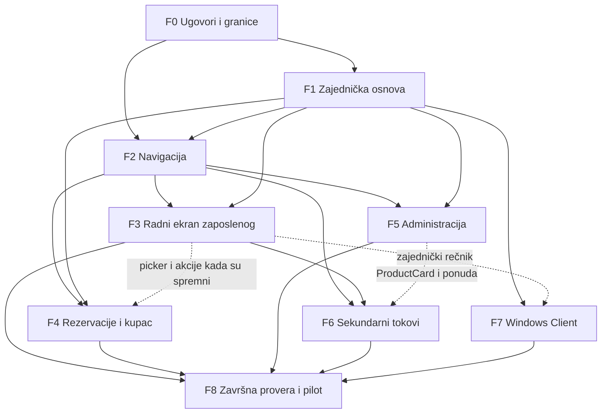

# G-Manager — plan pojednostavljenja UI/UX-a


> **Istorijski dokument.** Sačuvan radi projektantskog konteksta i ranijih nalaza. Opisi, komande i rezultati u nastavku nisu potvrda trenutnog ponašanja niti važeće operativno uputstvo. Koristite [aktuelnu dokumentaciju](../../README.md) i [nalaze pregleda od 1. novembra 2026.](../../MAINTENANCE_AUDIT.md).

Datum: 29. oktobar 2026. Polazni commit: `9834e30`.

**Status: analiza i predlog, bez implementacije.** U ovoj fazi dodat je samo ovaj dokument. Aplikacioni kod nije menjan; aplikacija, build, lint, typecheck i testovi nisu pokretani.

## 1. Cilj, obuhvat i pouzdanost nalaza

Glavni cilj je da novi zaposleni može da pronađe slobodan računar, registruje klijenta, pokrene, produži i završi sesiju sa jednog radnog ekrana, a kupac samostalno pronađe i rezerviše termin. Postojeće poslovne mogućnosti, API ugovori i autorizacija ostaju očuvani.

Analiza obuhvata svih **23 stranice u `src/pages`**, njihove rute, deljene i domenske komponente, 28 CSS fajlova, frontend API adaptere, relevantne backend kontrolere, servise i politike. Obuhvaćen je i zaseban WPF Gaming Client u `client/src/GManager.Client.Shell`, jer predstavlja dodatni korisnički interfejs istog sistema. Generisani binarni sadržaj `client/artifacts` nije izvor UX pravila.

Ovo je **statička analiza repozitorijuma**, bez vizuelnog pregleda pokrenute aplikacije i bez istraživanja sa korisnicima. Nalazi o rutama, uslovima prikaza, poljima i pravilima neposredno proizlaze iz koda. Procene vizuelnog opterećenja i efikasnosti predstavljaju stručne hipoteze koje treba proveriti u kasnijoj fazi. Nisu izmereni stvarna brzina, broj grešaka korisnika, kontrast u svim stanjima, ponašanje na uređajima ili vreme izvršavanja tokova.

Kada se dokumentacija i kod razlikuju, prednost ima kod: na primer, `docs/contracts/GAMING_OPERATIONS_WORKFLOW.md` navodi periodični resync od 30 s, dok `gaming/useGamingOperations.ts` koristi 15 s.

### 1.1. Oznake

| Oznaka | Značenje |
| --- | --- |
| P0 | Preduslov bezbednog pojednostavljenja: tačan status, dozvole, očuvanje zahteva i poslovnih pravila. Nije tvrdnja da svaki nalaz predstavlja potvrđen incident. |
| P1 | Svakodnevni tokovi zaposlenog i samostalna rezervacija kupca. |
| P2 | Administrativna efikasnost, doslednost i sekundarni tokovi. |
| P3 | Dodatno vizuelno doterivanje i napredne mogućnosti koje nisu preduslov osnovnog rada. |
| S | Lokalna promena sadržaja ili prezentacije u jednoj oblasti. |
| M | Nekoliko komponenti i stanja unutar iste oblasti. |
| L | Više stranica, deljeni state ili značajna reorganizacija toka. |
| XL | Koordinisana promena više domena i navigacije; isporučivati u manjim celinama. |

Kompleksnost uključuje buduću proveru regresije, ali ne predstavlja procenu u radnim danima. Prioritet i kompleksnost navedeni su uz svaki paket promene; detalji nasleđuju oznake svog paketa.

### 1.2. Registar izvora

Putanje u nastavku su relativne u odnosu na ovaj dokument. U ostatku plana `src/` znači `frontend/g-manager/src/`, a `backend/` znači `gm/src/main/java/com/game_manager/gm/`. Nazivi novih komponenti eksplicitno su označeni kao predlog.

| Izvor | Konkretno uporište |
| --- | --- |
| E01 | [App.tsx](../../../frontend/g-manager/src/App.tsx), [navigation.ts](../../../frontend/g-manager/src/layout/navigation.ts), [AppShell.tsx](../../../frontend/g-manager/src/layout/AppShell.tsx), [ProtectedRoute.tsx](../../../frontend/g-manager/src/auth/ProtectedRoute.tsx): sve rute, početne stranice, navigacija, nalog i povratak posle prijave. |
| E02 | [capabilities.ts](../../../frontend/g-manager/src/auth/capabilities.ts), [RolePermissions.java](../../../gm/src/main/java/com/game_manager/gm/common/security/RolePermissions.java), [UserAuthorizationPolicy.java](../../../gm/src/main/java/com/game_manager/gm/user/UserAuthorizationPolicy.java), [ResourceAccessService.java](../../../gm/src/main/java/com/game_manager/gm/resource/ResourceAccessService.java): prava i opseg upravljanja. |
| E03 | [DashboardPage.tsx](../../../frontend/g-manager/src/pages/DashboardPage.tsx), [EmployeeDashboard.tsx](../../../frontend/g-manager/src/dashboard/EmployeeDashboard.tsx), [DashboardComponents.tsx](../../../frontend/g-manager/src/dashboard/DashboardComponents.tsx), [GamingOverview.tsx](../../../frontend/g-manager/src/gaming/GamingOverview.tsx). |
| E04 | [GamingSessionsPage.tsx](../../../frontend/g-manager/src/pages/GamingSessionsPage.tsx), [GamingStationViews.tsx](../../../frontend/g-manager/src/gaming/GamingStationViews.tsx), [StartSessionDialog.tsx](../../../frontend/g-manager/src/gaming/StartSessionDialog.tsx), [useGamingOperations.ts](../../../frontend/g-manager/src/gaming/useGamingOperations.ts). |
| E05 | [GamingSessionService.java](../../../gm/src/main/java/com/game_manager/gm/gamingsession/GamingSessionService.java), [GamingSessionTransitionPolicy.java](../../../gm/src/main/java/com/game_manager/gm/gamingsession/GamingSessionTransitionPolicy.java), [GamingOperationsBoardService.java](../../../gm/src/main/java/com/game_manager/gm/gamingsession/operations/GamingOperationsBoardService.java), [StationReadinessService.java](../../../gm/src/main/java/com/game_manager/gm/station/StationReadinessService.java). |
| E06 | [ReservationsPage.tsx](../../../frontend/g-manager/src/pages/ReservationsPage.tsx), [StaffReservationForm.tsx](../../../frontend/g-manager/src/reservations/StaffReservationForm.tsx), [ReservationDetailsDrawer.tsx](../../../frontend/g-manager/src/reservations/ReservationDetailsDrawer.tsx), [ReservationEditForm.tsx](../../../frontend/g-manager/src/reservations/ReservationEditForm.tsx). |
| E07 | [CalendarPage.tsx](../../../frontend/g-manager/src/pages/CalendarPage.tsx), [CalendarTimeline.tsx](../../../frontend/g-manager/src/calendar/CalendarTimeline.tsx), [CalendarWeek.tsx](../../../frontend/g-manager/src/calendar/CalendarWeek.tsx), [CalendarMonth.tsx](../../../frontend/g-manager/src/calendar/CalendarMonth.tsx). |
| E08 | [ReservationService.java](../../../gm/src/main/java/com/game_manager/gm/reservation/ReservationService.java), [ReservationTransitionPolicy.java](../../../gm/src/main/java/com/game_manager/gm/reservation/ReservationTransitionPolicy.java), [ReservationDurationPolicy.java](../../../gm/src/main/java/com/game_manager/gm/resource/ReservationDurationPolicy.java), [reservationApi.ts](../../../frontend/g-manager/src/api/reservationApi.ts). |
| E09 | [MyReservationsPage.tsx](../../../frontend/g-manager/src/pages/MyReservationsPage.tsx), [CustomerBookingDialog.tsx](../../../frontend/g-manager/src/reservations/customer/CustomerBookingDialog.tsx), [CustomerReservationCard.tsx](../../../frontend/g-manager/src/reservations/customer/CustomerReservationCard.tsx), [CustomerWaitlist.tsx](../../../frontend/g-manager/src/reservations/customer/CustomerWaitlist.tsx). |
| E10 | [CustomerHomePage.tsx](../../../frontend/g-manager/src/pages/CustomerHomePage.tsx), [CustomerHomeComponents.tsx](../../../frontend/g-manager/src/dashboard/customer/CustomerHomeComponents.tsx), [CustomerHomeComponents.model.ts](../../../frontend/g-manager/src/dashboard/customer/CustomerHomeComponents.model.ts). |
| E11 | [CustomersPage.tsx](../../../frontend/g-manager/src/pages/CustomersPage.tsx), [CustomerFormDialog.tsx](../../../frontend/g-manager/src/customers/CustomerFormDialog.tsx), [CustomerProfile.tsx](../../../frontend/g-manager/src/customers/CustomerProfile.tsx), [CustomerCrmPanel.tsx](../../../frontend/g-manager/src/customers/CustomerCrmPanel.tsx), [CustomerAccountService.java](../../../gm/src/main/java/com/game_manager/gm/customer/CustomerAccountService.java). |
| E12 | [EmployeesPage.tsx](../../../frontend/g-manager/src/pages/EmployeesPage.tsx), [UserManagementPage.tsx](../../../frontend/g-manager/src/pages/UserManagementPage.tsx), [NewEmployeeDialog.tsx](../../../frontend/g-manager/src/employees/NewEmployeeDialog.tsx), [NewUserDialog.tsx](../../../frontend/g-manager/src/users/NewUserDialog.tsx), [EmployeeLocationDialog.tsx](../../../frontend/g-manager/src/employees/EmployeeLocationDialog.tsx). |
| E13 | [ResourcesPage.tsx](../../../frontend/g-manager/src/pages/ResourcesPage.tsx), [ResourceFloorMap.tsx](../../../frontend/g-manager/src/resources/ResourceFloorMap.tsx), [ResourceEditor.tsx](../../../frontend/g-manager/src/resources/ResourceEditor.tsx), [ResourceTable.tsx](../../../frontend/g-manager/src/resources/ResourceTable.tsx). |
| E14 | [StationsPage.tsx](../../../frontend/g-manager/src/pages/StationsPage.tsx), [StationDetails.tsx](../../../frontend/g-manager/src/stations/StationDetails.tsx), [StationConfigurationDialogs.tsx](../../../frontend/g-manager/src/stations/StationConfigurationDialogs.tsx), [StationIdentityDialog.tsx](../../../frontend/g-manager/src/stations/StationIdentityDialog.tsx), [StationAdministration.tsx](../../../frontend/g-manager/src/stations/StationAdministration.tsx). |
| E15 | [CatalogPage.tsx](../../../frontend/g-manager/src/pages/CatalogPage.tsx), [CatalogCard.tsx](../../../frontend/g-manager/src/catalog/CatalogCard.tsx), [CatalogDetails.tsx](../../../frontend/g-manager/src/catalog/CatalogDetails.tsx), [CatalogFormDialog.tsx](../../../frontend/g-manager/src/catalog/CatalogFormDialog.tsx). |
| E16 | [OrdersPage.tsx](../../../frontend/g-manager/src/pages/OrdersPage.tsx), [MyOrdersPage.tsx](../../../frontend/g-manager/src/pages/MyOrdersPage.tsx), [OrderActionsMenu.tsx](../../../frontend/g-manager/src/order/OrderActionsMenu.tsx), [useCustomerCart.ts](../../../frontend/g-manager/src/order/customer/useCustomerCart.ts), [OrderAuthorizationPolicy.java](../../../gm/src/main/java/com/game_manager/gm/order/OrderAuthorizationPolicy.java). |
| E17 | [WaitlistPage.tsx](../../../frontend/g-manager/src/pages/WaitlistPage.tsx), [WaitlistEntryDialog.tsx](../../../frontend/g-manager/src/waitlist/WaitlistEntryDialog.tsx), [WaitlistDetailsPanel.tsx](../../../frontend/g-manager/src/waitlist/WaitlistDetailsPanel.tsx), [WaitlistAccessPolicy.java](../../../gm/src/main/java/com/game_manager/gm/waitlist/WaitlistAccessPolicy.java). |
| E18 | [SettingsPage.tsx](../../../frontend/g-manager/src/pages/SettingsPage.tsx), [SetupOverview.tsx](../../../frontend/g-manager/src/settings/SetupOverview.tsx), [WorkingHoursSettings.tsx](../../../frontend/g-manager/src/settings/WorkingHoursSettings.tsx), [WorkingHoursExceptions.tsx](../../../frontend/g-manager/src/settings/WorkingHoursExceptions.tsx), [EmployeeTimeOffSettings.tsx](../../../frontend/g-manager/src/settings/EmployeeTimeOffSettings.tsx). |
| E19 | [ReportsPage.tsx](../../../frontend/g-manager/src/pages/ReportsPage.tsx), [reportApi.ts](../../../frontend/g-manager/src/api/reportApi.ts), [ReportService.java](../../../gm/src/main/java/com/game_manager/gm/report/ReportService.java), [ReportGenerator.java](../../../gm/src/main/java/com/game_manager/gm/report/ReportGenerator.java), [ReportJobHandler.java](../../../gm/src/main/java/com/game_manager/gm/report/ReportJobHandler.java). |
| E20 | [AuditPage.tsx](../../../frontend/g-manager/src/pages/AuditPage.tsx), [AuditFilterDialog.tsx](../../../frontend/g-manager/src/audit/AuditFilterDialog.tsx), [AuditDetailsPanel.tsx](../../../frontend/g-manager/src/audit/AuditDetailsPanel.tsx). |
| E21 | [ProfilePage.tsx](../../../frontend/g-manager/src/pages/ProfilePage.tsx), [SessionPage.tsx](../../../frontend/g-manager/src/pages/SessionPage.tsx), [NotificationPreferencesPage.tsx](../../../frontend/g-manager/src/pages/NotificationPreferencesPage.tsx), [LoginPage.tsx](../../../frontend/g-manager/src/pages/LoginPage.tsx), [ActivatePage.tsx](../../../frontend/g-manager/src/pages/ActivatePage.tsx). |
| E22 | [tokens.css](../../../frontend/g-manager/src/styles/tokens.css), [ui/index.tsx](../../../frontend/g-manager/src/components/ui/index.ts), [ui.css](../../../frontend/g-manager/src/components/ui/ui.css), [App.css](../../../frontend/g-manager/src/App.css), [product.css](../../../frontend/g-manager/src/styles/product.css), [Tabs.tsx](../../../frontend/g-manager/src/components/ui/Tabs.tsx). |
| E23 | [ConfirmDialog.tsx](../../../frontend/g-manager/src/components/ui/ConfirmDialog.tsx), [ActionDialog.tsx](../../../frontend/g-manager/src/components/ui/ActionDialog.tsx), [useDirtyGuard.ts](../../../frontend/g-manager/src/forms/useDirtyGuard.ts), [useListUrlState.ts](../../../frontend/g-manager/src/lists/useListUrlState.ts), [SavedViewBar.tsx](../../../frontend/g-manager/src/components/lists/SavedViewBar.tsx), [SelectionBar.tsx](../../../frontend/g-manager/src/components/lists/SelectionBar.tsx). |
| E24 | [CommandPalette.tsx](../../../frontend/g-manager/src/search/CommandPalette.tsx), [NotificationCenter.tsx](../../../frontend/g-manager/src/notification/NotificationCenter.tsx), [ConnectivityBanner.tsx](../../../frontend/g-manager/src/pwa/ConnectivityBanner.tsx), [client.ts](../../../frontend/g-manager/src/api/client.ts), [idempotency.ts](../../../frontend/g-manager/src/api/idempotency.ts), [featureStore.ts](../../../frontend/g-manager/src/feature/featureStore.ts). |
| E25 | [MainWindow.xaml](../../../client/src/GManager.Client.Shell/MainWindow.xaml), [MainWindow.xaml.cs](../../../client/src/GManager.Client.Shell/MainWindow.xaml.cs), [DashboardView.xaml](../../../client/src/GManager.Client.Shell/Views/DashboardView.xaml), [DashboardView.xaml.cs](../../../client/src/GManager.Client.Shell/Views/DashboardView.xaml.cs), [ShellTheme.xaml](../../../client/src/GManager.Client.Shell/Resources/ShellTheme.xaml), [DashboardTheme.xaml](../../../client/src/GManager.Client.Shell/Resources/DashboardTheme.xaml). |

## 2. Šta već dobro funkcioniše

Redizajn treba da razvije postojeću osnovu, a ne da pravi paralelan UI sistem:

- Postoje centralni tokeni, tamna i svetla tema, dve gustine prikaza, deljeni `Button`, `FormField`, `Card`, `StatCard`, `TableShell`, `Pagination`, `Modal`, `Drawer`, `Tabs` i obaveštenja. `PageLayout` već koristi punu širinu; prazninu pored sidebar-a ne treba unapred pripisivati globalnom `max-width` ograničenju. E22.
- Navigacija i rute proveravaju capabilities, a `hasCapability` daje prednost dozvolama dobijenim u korisničkoj sesiji. Backend dodatno proverava ulogu, vlasništvo i dodele resursa. E01–E02.
- Gaming operativa već ima akcije na kartici, `+30`, `+60`, prilagođeno produženje, razloge završetka, serversko vreme, SSE, polling i oporavak zaključavanja. Ne treba predstavljati postojeći `+30` u jednom kliku kao novu funkciju. E04–E05.
- Rezervacije već dele formu za osoblje i detaljni prikaz između liste i kalendara. Podržani su stvarna dostupnost intervala, alternative, automatska dodela, rad preko ponoći i serije rezervacija. E06–E09.
- Postoje fokusni trap, vraćanje fokusa, `inert` pozadina, podrška za složene dijaloge, reduced motion, skip link i mobilna navigacija. To se mora sačuvati pri izvlačenju komponenti. E22–E24.
- Korpa već čuva pokušaj slanja i isti idempotency ključ; nalog i cache imaju mehanizme izolacije. CRM je odvojen dozvolom, aktivaciona tajna se prikazuje samo jednom. E11, E16, E24.

Glavni problem je **raspodela pažnje i odgovornosti**: mnogo ulaza u slične podatke, previše pregleda i filtera pre glavnog zadatka, različita pravila prezentacije iste akcije i nedovoljno jasne granice između operativnog i tehničkog stanja.

## 3. Uloge, stvarni zadaci i granice mogućnosti

### 3.1. Matrica ovlašćenja

| Oblast | OWNER | ADMIN | EMPLOYEE | CUSTOMER |
| --- | --- | --- | --- | --- |
| Početna | Poslovni i operativni dashboard | Isti skup dashboard dozvola, operativni naglasak | Moj radni dan | Lična početna |
| Gaming sesije | Čitanje/start/extend/terminate/recovery | Isto | Isto, na trenutno dodeljenim resursima | Samo sopstvene posete i preostalo vreme |
| Rezervacije | Sve, kreiranje/status/izmena/dodela | Isto | Pregled ALL ili MANAGEABLE; upravljanje dodeljenim resursima; izuzetak za sopstvenu nefizičku uslugu | Kreiranje, sopstveni pregled i dozvoljeno otkazivanje; bez direktne izmene |
| Lista čekanja | Operativni pregled i upravljanje | Isto | Isto uz backend pravila opsega | Sopstvene prijave, prihvatanje važeće ponude, otkazivanje |
| Resursi i mapa | Upravljanje lokacijama/zonama/resursima/mapom/dodelama | Isto | Čitanje; nema `RESOURCE_MANAGE` | Čitanje relevantne ponude i dostupnosti |
| PC konfiguracija | Održavanje, aplikacije/profili, machine identity | Isto | `STATION_READ`; bez podešavanja i enrollment upravljanja | Bez `STATION_READ` |
| Klijenti | Create/read/ograničen update/deactivate, CRM | Isto | Create/read/ograničen update/deactivate; bez CRM | Sopstveni profil |
| Korisnički nalozi | Kreiranje ADMIN i EMPLOYEE; kontrola drugih naloga osim OWNER i sebe | Kreiranje i kontrola EMPLOYEE; upravljački spiskovi su ograničeni backendom | Nema opšteg user management-a | Nema |
| Katalog | Create/edit/aktivacija/deaktivacija/soft delete/restore/slike | Isto | Samo aktivna ponuda | Samo aktivna ponuda, rezervacija usluge i kupovina proizvoda |
| Narudžbine | Sve i dozvoljeni prelazi | Isto | Preuzimanje; obrada u skladu sa handler pravilima | Kreiranje i svoje narudžbine; otkazivanje samo `CREATED` |
| Izveštaji | `REPORT_READ` i `REPORT_MANAGE` | Isto | `REPORT_READ`, uključuje generisanje; bez rasporeda | Nema report rute/dozvole |
| Radno vreme, izuzeci, odsustva | Upravljanje | Isto | Nema upravljačku stranicu podešavanja | Nema upravljačku stranicu podešavanja |
| Audit / feature management | Ima dozvole | Ima dozvole | Nema | Nema |
| Nalog | Profil/avatar/lozinka, prijavljeni uređaji, preference obaveštenja | Isto | Isto | Isto |

Izvori: E01–E02 i domenske politike E05, E08, E16–E19. Jednake permission liste za OWNER i ADMIN ne znače jednaka prava nad ciljnim korisnikom: `UserAuthorizationPolicy`, `UserService` i frontend `allowedUserActions` dodatno ograničavaju cilj. `EMPLOYEE_LIST` služi i za izbor zaposlenog pri rezervaciji; nije dozvola za administrativnu stranicu zaposlenih.

**Dodela lokacije zaposlenom trenutno primenjuje pristup na postojeće stanice.** `EmployeeLocationDialog` izričito navodi da naknadno dodate stanice zahtevaju novu dodelu. Novi UI ne sme da prikaže ovo kao trajno nasleđivanje svih budućih resursa lokacije. E12, E02.

### 3.2. Mogućnosti koje se ne smeju pretpostaviti

| Pitanje | Nalaz iz koda | Posledica za plan |
| --- | --- | --- |
| Može li kupac da promeni termin? | `ReservationService.canEdit` isključuje CUSTOMER; `resourceOptions` za izmenu zahteva `RESERVATION_READ_ALL`. Opis `MyReservationsPage` ipak pominje „izmenu“. | P0: popraviti obećanje u tekstu. Ponovno zakazivanje je novi zahtev; ne predstavljati cancel + create kao atomsku izmenu. Direktno pomeranje kupca ostaje van ovog plana bez nove poslovne odluke/API-a. |
| Imaju li konzole isti live lifecycle kao PC? | `StationReadinessService` i gaming board rade sa `GAMING_PC`; mapa podržava i PLAYSTATION, SIMULATOR, VIP_ROOM, OTHER. | PC ima start/extend/end. Konzole i drugi resursi imaju rezervacije/dostupnost. Ne dodavati lažne countdown-e ili PC komande. |
| Postoje li naplata gaming minuta, kasa i dugovanja? | Postoje cena kataloga, narudžbine, revenue i izveštaji; gaming sesija nema tok naplate u pregledanim UI/API ugovorima. | Ne obećavati račun za sesiju, stanje blagajne, refund, kredit, pretplatu ili poreski obračun. |
| Šta znači prihod? | Dashboard navodi prihod završenih narudžbina; report `revenue` grupiše ukupne iznose narudžbina po statusu. | Zadržati definiciju uz broj. Ne sabirati proizvoljno sve statuse i nazivati ih realizovanim prihodom. |
| Da li zaposleni vidi samo svoju smenu? | Postoje dnevni dashboard, odsustva i dodele; nije pronađen kompletan sistem evidencije radnih smena. | „Moj radni dan“ ne preimenovati u evidenciju prisustva ili blagajničku smenu. |
| Postoji li javna registracija/reset lozinke? | Javna registracija je isključena; postoji staff onboarding i `/activate`. Nema pronađene reset-password stranice. | Ne dodavati linkove ka nepostojećem self-service resetu ili javnoj registraciji. |
| Da li reports za zaposlenog znači lični izveštaj? | `ReportJobHandler` daje širok skup podataka ako snapshot ima oba READ_ALL prava, koja EMPLOYEE ima. Lista generisanih fajlova je po vlasniku zahteva. | Ne tvrditi da je sadržaj automatski ograničen na dodeljene stanice/sopstvene narudžbine. Zadržati trenutno pravo i jasno navesti opseg; promenu bezbednosne politike izdvojiti iz UX rada. |
| Postoje li UI za sve API mogućnosti? | `featureApi.list/update` postoje, ali nisu povezani u settings UI; `documentApi` nije zasebna stranica. Report šabloni se kreiraju, ali `ReportsPage` ne učitava listu preko `templates()`. | Razlikovati postojeći UI od postojećeg API-a. Povezivanje šablona je posebna P2 dopuna UI-a; feature management i document browser nisu izmišljene postojeće stranice. |

## 4. Registar glavnih problema i konkretnih promena

Svaki paket navodi postojeće stanje, problem, promenu, očekivani rezultat, fajlove i korist. Preporuke po stranicama u odeljku 7 dopunjuju ovaj registar.

| ID / prioritet / složenost | Trenutno stanje i problem | Konkretna promena i rezultat | Obuhvat i korist |
| --- | --- | --- | --- |
| U01 · P1 · L | Navigacija ima do 18 stavki za management, 14 za zaposlenog, 8 za kupca kada je REPORTS uključen. Nalog se ponavlja u sidebar-u i account drawer-u. | Primarna navigacija po zadacima; nalog samo u jednom sekundarnom ulazu; grupe opisane u odeljku 5. Stare rute ostaju dostupne. | E01: `navigation.ts`, `AppShell.tsx`, `App.tsx`. Manje izbora pre početka rada. |
| U02 · P1 · XL | EmployeeDashboard prikazuje termine i narudžbine, a `GamingOverview` vodi na drugu stranicu za stvarni rad sa računarima. | Centralni „Radni ekran“ koristi postojeću gaming tablu, uz sažete dolaske, narudžbine i važne događaje. Gaming akcije ostaju u jednom kontroleru. | E03–E04: dashboard, gaming page/hook/views. Zaposleni obavlja najčešći posao bez promene stranice. |
| U03 · P1 · M | Gaming operativa ponavlja istu populaciju kroz KPI, tri alert dugmeta, pet osnovnih filtera, status select, tri checkbox-a, kartice, detalje i tabelu. | Jedan niz filtera Svi/Slobodni/Aktivni/Za proveru; „Ističu“ kao podfilter; ostalo pod „Više filtera“. Kartice ili tabela kao alternativni prikaz, detalji samo za izabranu stanicu. | E04, `gamingOperations.css`. Veći deo prvog ekrana pripada računarima. Sačuvati sve filtere i mogućnost kombinovanja. |
| U04 · P1 · M | Start dialog kaže da se nepostojeći klijent kreira u odeljku Klijenti; nema nastavka registracije u istom toku. | Ugnježdeni korak „Novi klijent“ u istom radnom kontekstu, pa nastavak starta sa potvrđenim ID-em. Jednokratni kod mora ostati vidljiv do predaje. | E04, E11: `StartSessionDialog`, `CustomerFormDialog`, `customerApi`. Manje vraćanja i ponovljenog unosa. |
| U05 · P1 · L | Lista rezervacija i kalendar imaju odvojene KPI, filtere i navigacione stavke; lista čekanja je treća stranica. | Jedna oblast „Rezervacije“ sa prikazima Raspored/Lista/Čekanje; isti kontekst datuma, lokala i resursa gde semantika to dozvoljava. | E06–E09, E17; bez promene API-a. Manje prebacivanja i ponovnog filtriranja. |
| U06 · P1 · L | Customer booking prikazuje zaposlenog kao obavezan izbor pre datuma, lokal, zonu, resurs, ručni Od–Do i ponuđene slotove. | Tri jasno ograničene celine: usluga/prostor → datum, trajanje i slobodan početak → pregled. „Bilo koji zaposleni“ podrazumevano za pojedinačni termin; konkretan zaposleni, resurs i serija pod dodatnim opcijama. | E09 i E08. Manje poslovnih odluka za kupca; fizički scope i pravila serije ostaju obavezni. |
| U07 · P0 · M | Customer opis obećava izmenu, iako je zabranjena. Kreiranje šalje PENDING, dok dugme „Potvrdi termin“ može sugerisati konačnu potvrdu. | Uskladiti naziv CTA i uspeh sa stvarnim statusom: „Pošalji rezervaciju“, zatim „Zahtev poslat — čeka potvrdu“. Objasniti podržano otkazivanje i novo zakazivanje. | E08–E09. Kupac zna šta je uspešno završeno i šta još čeka osoblje. |
| U08 · P0 · L | Mapa prikazuje budući 60-minutni interval; station status, active session, heartbeat i lock ACK su različiti signali. | Jasni naslovi „Dostupnost za termin“ i „Stanje računara sada“; operativni status, veza i zaključavanje prikazuju se odvojeno. Nikad svesti sve na zeleno/crveno. | E04–E05, E13–E14. Sprečava pogrešan zaključak da je računar slobodan ili zaključan. |
| U09 · P0 · L | Gaming komande i rezervacije čuvaju pending zahteve, ali kontrola greške, blokade i retry-a je raspoređena po velikim komponentama. `StartSessionDialog` zaključava polja i za retryRequest, dok close zaštita proverava samo busy; zatvaranje posle nepoznatog ishoda može izgubiti lokalni retry kontekst. | Jedinstven vizuelni obrazac „Ishod nije potvrđen / proveri isti zahtev“, uz očuvanje domenskih state machine-a. Definisati bezbedan izlaz iz pending toka, ujednačiti zastarele podatke i razloge blokade. | E04, E06, E09, E16, E24. Manje duplih pokušaja i jasniji oporavak; ne resetovati ključ radi jednostavnijeg UI-a. |
| U10 · P2 · L | `EmployeesPage` i `UserManagementPage` ponavljaju list/detail layout, nalog i create forme; dodele i odsustva žive na više mesta. | Jedna oblast „Tim i pristup“ sa sekcijama Zaposleni/Nalozi/Obrisani i kontekstualnim dodelama/odsustvima. Deliti osnovu forme, zadržati različita pravila. | E12, E18. Administrator lakše završava onboarding zaposlenog. |
| U11 · P2 · L | Stanice nude operativne kartice, tehničke detalje, paket klijenta i administraciju aplikacija na istoj dugoj stranici; „Nova stanica“ samo vodi na mapu. | „Oprema“ objedinjuje prostor, resurse i PC konfiguraciju. Vodič za dodavanje: resurs → profil → konfiguracija → po potrebi enrollment → provera spremnosti. | E13–E14. Postojeći ekran dobija jasno odvojene operativne i administrativne odgovornosti. |
| U12 · P2 · M | Isti katalog usluga/proizvoda ima administrativni opis i za kupca; proizvodi se ponovo listaju u `MyOrdersPage`. | Deljena prezentacija proizvoda uz različite kontekste Ponuda i Upravljanje; kupac ulazi u kupovinu direktno, bez obaveznog drugog istraživanja kataloga. | E15–E16. Zadržati sve pretrage, cene i akcije, uz manje dupliranja. |
| U13 · P1 · M | OrdersPage potvrđuje i redovne statusne prelaze dijalogom; EmployeeDashboard neke iste prelaze izvršava direktno. | Preuzimanje i označavanje spremnim direktno, uz spinner i potvrdu ishoda; terminalni/destruktivni prelazi sa jedinstvenom potvrdom. | E03, E16. Brža obrada uz ista handler/version pravila. |
| U14 · P2 · M | ReportsPage ima fiksno „ponedeljkom 08:00“, čuvanje šablona bez korišćenja, UTC ponoć uz lokalnu oznaku zone i stalni polling od 5 s. | Jednostavan generator + istorija; šabloni i rasporedi u posebnoj sekciji; jasan [od, do) period i konverzija poslovnih datuma; polling prema pending poslovima. | E19. Predvidljivi izveštaji i jasne definicije; promenu značenja prihoda ne raditi prećutno. |
| U15 · P2 · L | Baza komponenti postoji, ali domeni imaju ručne tabs/menije, različite primary boje i CSS override-e. Pagination nazivi su različiti, ali adapteri već delegiraju zajedničkoj osnovi. | Proširiti postojeći design system i objediniti preostala ponašanja; sačuvati već zajedničke komponente. Domenski prikazi ostaju specifični. Detalji su u odeljku 9. | E12–E24. Doslednost bez velike jednokratne zamene aplikacije. |
| U16 · P1 · L | Responsivnost postoji, ali koristi i viewport i lokalne pragove 767/800/1100/1250; master-detail meri 60rem ili 1088px; gaming tabela ima min-width 70rem. | Deljeni obrazac po raspoloživoj širini sadržaja, mobilna agenda/lista i detalji na zahtev. Horizontalni scroll ostaje samo za suštinski dvodimenzionalan sadržaj. | E04, E07, E12–E14, E20, E22. Pouzdanije korišćenje sa otvorenim sidebar-om i uvećanim tekstom. |
| U17 · P2 · M | `useDirtyGuard` čuva samo beforeunload; neke stranice posebno presreću interne linkove, druge se oslanjaju na close confirmation. | Jedinstven ugovor za izlazak iz izmenjene forme i prekid toka, uključujući internu navigaciju i Back. Posebno tretirati sačuvan rezultat i nepoznat ishod komande. | E21–E24, catalog/customer/resource/station forme. Manje gubitka unosa bez nepotrebnih potvrda za neizmenjene forme. |
| U18 · P2 · M | WPF Shell ponavlja vreme i informacije u centralnom i desnom panelu; dekorativni login i dodatne preference zauzimaju prostor. | Aplikacije + jedan jasan tajmer + sažet status; detalji, pomoć i preference ostaju dostupni sekundarno. Uskladiti rečnik i semantičke boje sa webom. | E25. Lakši početak igre bez promene service/lease/enforcement protokola. |

Važno ograničenje U08: board `allowedActions.START` označava dozvoljenu kandidatsku akciju, ali nije garancija slobodnog celog proizvoljnog trajanja. `GamingOperationsBoardService` ne izvršava kompletnu intervalsku proveru iz `GamingSessionService.start`. Zato broj „Spremni za pokretanje“ mora imati odgovarajuće značenje; konačnu dostupnost, profil i konflikt potvrđuje start zahtev. Pozitivan indikator ne sme obećavati uspeh bez te provere.

## 5. Nova navigacija i očuvanje ruta

### 5.1. OWNER

Sedam primarnih stavki: **Pregled, Radni ekran, Rezervacije, Narudžbine, Klijenti, Oprema, Upravljanje**. „Upravljanje“ otvara pregled sa ravnopravnim karticama Tim i pristup, Ponuda i cene, Radno vreme, Izveštaji, Evidencija promena. Nema dodatnih višestrukih sidebar podmenija.

Poslovni rezultati su početni naglasak „Pregleda“, ali prvi blok mora jasno odvojiti „Danas“ i izabrani obračunski period. Napredni export, widget preference i AI nisu na putu ka svakodnevnim akcijama.

### 5.2. ADMIN

Iste primarne oblasti kao OWNER, sa početnim operativnim „Pregledom“. Unutar „Tim i pristup“ podrazumevano Zaposleni. Prikaz i akcije nad ciljnom ulogom ostaju ograničeni backendom; objedinjavanje oblasti ne daje ADMIN-u pravo da upravlja administratorima, vlasnikom ili klijentima kroz pogrešan API.

### 5.3. EMPLOYEE

Pet primarnih stavki: **Radni ekran, Rezervacije, Narudžbine, Klijenti, Alati**. „Alati“ daje brze ulaze u Ponudu, Mapu dostupnosti, read-only informacije o PC stanicama i Izveštaje ako je REPORTS uključen. Na radnom ekranu postoji „Mapa“ kao izbor prikaza/povezana pomoć, bez pretvaranja buduće dostupnosti u live status.

Zaposleni odmah vidi opseg „Moje dodeljene stanice“. U rezervacijama ostaje mogućnost „Sve stanice — samo pregled gde nemate pravo upravljanja“. „Nemate dodeljene stanice“ ima objašnjenje i sledeći korak, bez sugerisanja da zaposleni sam sebi može dodeliti prava.

### 5.4. CUSTOMER

Četiri primarna ulaza: **Početna, Rezerviši, Moji termini, Ponuda**. Narudžbine su jasno imenovana sekcija Ponude i prečica uz aktivnu narudžbinu; mapa je kontekstualni izbor „Izaberi mesto“ u rezervisanju. „Rezerviši“ je naglašena akcija koja otvara postojeći booking tok, ne nova administrativna stranica.

Na malom ekranu ove četiri stavke mogu biti donja navigacija; profil je u zaglavlju. „Moje narudžbine“ mora biti dostupan u jednom koraku iz Ponude i početne kada postoji aktivna narudžbina. Ako kasnija provera pokaže čestu kupovinu, može zameniti primarni ulaz Ponuda, bez promene poslovnih mogućnosti.

### 5.5. Zajednički sekundarni ulazi

Avatar otvara **Moj nalog**: Profil, Bezbednost i uređaji, Podešavanja obaveštenja, Izgled i gustina, Odjava. Zvonce ostaje centar stvarnih obaveštenja sa linkom ka njihovim preferencama. Tema i gustina više se ne ponavljaju u sidebar footer-u, mobilnom meniju i account drawer-u. Svetla tema ostaje podržana iako je tamna podrazumevana.

Globalna pretraga ostaje dostupna i preko Ctrl/Cmd+K. Ne zamenjuje jasne primarne ulaze i domensku pretragu. Rezultati ostaju ograničeni backend autorizacijom; novi nazivi ruta ne smeju pokvariti serverom vraćene `action.url` vrednosti.

### 5.6. Mapa postojećih ulaza u novu organizaciju

| Postojeća ruta | Nova oblast / prikaz | Pravilo kompatibilnosti |
| --- | --- | --- |
| `/dashboard` | OWNER/ADMIN Pregled; EMPLOYEE Radni ekran | Različiti default prikazi po ulozi; sačuvati permission fallback iz `homeForUser`. |
| `/gaming-sessions` | Radni ekran, PC operativa | Sačuvati `stationId`, filtere i pagination; postojeće deep linkove. |
| `/calendar` | Rezervacije → Raspored | Dan/nedelja/mesec/lista ostaju dostupni; preneti postojeći `date/view/resourceId/reservationId`. |
| `/reservations` | Rezervacije → Lista | `create=true`, scope, saved views, detail i bulk ostaju. |
| `/waitlist` | Rezervacije → Čekanje | Samostalni URL ostaje validan, uključujući `customerId/entryId` i filtere. |
| `/resources` | Oprema → Prostor i resursi; EMPLOYEE Alati; CUSTOMER kontekstualna mapa | Različita prezentacija po pravu, isti API i URL parametri. |
| `/stations` | Oprema → PC konfiguracija; EMPLOYEE Alati → Informacije o stanicama | Nema management kontrola za EMPLOYEE; `stationId` ostaje validan. |
| `/customers` | Klijenti | Sačuvati `customerId`, search, listu i profil. |
| `/employees`, `/users` | Upravljanje → Tim i pristup | Obe rute ostaju odgovarajući ulazi, uključujući `focus` i obrisane naloge. |
| `/catalog` | Upravljanje → Ponuda i cene ili CUSTOMER Ponuda | Isti katalog; akcije prema capability-ju i ulozi. |
| `/orders`, `/my-orders` | Narudžbine osoblja / kupčeva Ponuda → Narudžbine | Sačuvati `focus`, `orderId`, `productId`, korpu i privatnost. |
| `/settings` | Upravljanje → Radno vreme i konfiguracija | Zadržati `#overview/#working-hours/#exceptions/#time-off` i postojeći alias `#timeoff`. |
| `/reports`, `/audit` | Upravljanje; EMPLOYEE izveštaji kroz Alate | Feature flag i dozvole ostaju; nema frontend zaobilaženja. |
| `/home`, `/my-reservations` | Kupčeva Početna / Moji termini / Rezerviši | Sačuvati booking prefill, `sessionId`, `reservationId`, `waitlistOffer` i sekcije. |
| `/profile`, `/sessions`, `/notification-preferences` | Moj nalog | `/sessions` jasno nazvati „Prijavljeni uređaji“ ili „Bezbednost i uređaji“. |
| `/login`, `/activate`, `/unauthorized`, fallback | Pristup aplikaciji | Sačuvati povratak na traženi dozvoljeni URL. Nedostupna/ugašena funkcija nije ista poruka kao nepostojeća stranica. |

Prvo promeniti organizaciju linkova i deljene sadržaje uz postojeće URL-ove. Eventualna kasnija kanonska ruta koristi eksplicitne redirect-e i mapiranje parametara, a ne brisanje starih ulaza.

## 6. Predloženi raspored i dashboard po ulozi

### 6.1. Zajednička struktura stranica

Operativne i tabelarne stranice koriste dostupnu širinu pored sidebar-a. Gore je jedan naslov, sažeta svrha i jedna dominantna akcija. Ispod ide kompaktan kontekst, zatim sam sadržaj. Velike KPI kartice nisu obavezan element svake CRUD stranice. Sekundarne statistike mogu biti sažeta traka ili zatvorena sekcija „Pregled“.

Detail panel je kontekstualan: desktop master-detail samo kada širina sadržaja dozvoljava da oba dela ostanu upotrebljiva; inače Drawer ili puna mobilna površina. Ne održavati istovremeno dve kompletne liste iste populacije samo radi različite prezentacije. Profil i kratke forme mogu imati čitljivu ograničenu širinu; mapa i raspored ostaju široki.

### 6.2. EMPLOYEE — centralni Radni ekran

Predložena struktura, zasnovana na E03–E07 i E16–E17:

```text
Radni ekran        [Lokacija / dodeljeni opseg]        [Nova sesija]
Veza i vreme poslednje potvrde     Slobodno  Aktivno  Ističe  Za proveru
[Pretraga računara ili klijenta] [Svi | Slobodni | Aktivni | Za proveru]
┌──────────────────────────────────┬───────────────────────────────┐
│ PC kartice ILI operativna lista   │ Izabrani računar              │
│ naziv, klijent, vreme, status     │ osnovne informacije + akcije  │
│ Pokreni / +30 / Završi            │ Napredno / istorija po potrebi│
└──────────────────────────────────┴───────────────────────────────┘
[Dolaze uskoro] [Narudžbine koje čekaju] [Važni događaji]
```

Rezultat: izbor slobodnog računara, sesija, produženje i završetak ostaju na istoj strani. `+30` zadržava jedan klik. `+60` i prilagođeno trajanje su u panelu ili „Još“. Za tehnički problem vidi se običan opis i dostupna sledeća radnja; heartbeat, ACK, sequence i support ID dostupni su u detaljima. Kritično „zaključavanje nije potvrđeno“ ostaje vidljivo i na kartici.

Dolazci i narudžbine su sažeti, sa dozvoljenom primarnom akcijom i „Vidi sve“. Odsustvo podataka u jednom sekundarnom modulu ne sme ukloniti funkcionalnu PC tablu. Postojeće sekcije dnevnih termina, praznina i assigned/unclaimed narudžbina ostaju dostupne u proširenom dnevnom pregledu. „Slobodni intervali“ dnevnog rasporeda nisu obećanje da je bilo koji PC slobodan.

Na manjim ekranima: kontekst → kritično upozorenje → pretraga i filteri → kartice. Izbor otvara detalje; nema trajnog panela ispod veoma duge liste niti još jedne pune tabele. Uvek sačuvati naziv i klijenta uz akciju da zaposleni ne produži pogrešnu sesiju.

**Podaci:** koristiti isti `useGamingOperations`/query kao izvor PC stanja; pri komponovanju ekrana ne praviti više SSE pretplata iz više montiranih `GamingOverview`/board prikaza. Dnevni pregled i narudžbine ostaju zasebni API moduli i cache ključevi. UI objedinjavanje nije nova backend agregacija.

### 6.3. OWNER — Pregled

Prvi red: datum „Danas“, slobodni/aktivni/problematični PC sa jasno naznačenim opsegom i linkom na Radni ekran. Drugi red: zahtevi rezervacija i narudžbine koje traže akciju. Poslovni blok ima sopstveni naslov „Rezultati za [od–do]“ i tri postojeće metrike: realizovan prihod završenih narudžbina, rezervacije i završene narudžbine.

Analitika, poređenje sa prethodnim periodom, opterećenje, prag, izbor zaposlenog, export trenutnih/sirovih podataka i redosled widgeta ostaju u postojećem analitičkom prikazu. Početni render ne treba da zavisi od uspeha svih analitičkih zahteva u `Promise.all`. E03. Predlog je razdvajanje učitavanja, bez promene formule metrike.

### 6.4. ADMIN — Pregled

Prvi red: zahtevi na čekanju, današnji termini, nepreuzete narudžbine i stanice za proveru. Drugi red: konkretna lista problema sa akcijom, a ne drugi set istih velikih brojila. Poslovna analitika ostaje dostupna istim pravima; nema ukidanja zato što je operativni prikaz podrazumevan. Prečice za konfiguraciju dostupne su samo kada otklanjaju uočeni problem.

### 6.5. CUSTOMER — Početna

Redosled sadržaja zavisi od stvarnog stanja:

1. Aktivna gaming sesija, ako postoji: mesto, preostalo vreme, planirani kraj i „Za produženje se obratite osoblju“. Može postojati više kartica ako API vrati više stavki; ne sakriti podatak zbog pretpostavke o jednoj sesiji.
2. Važeća ponuda sa liste čekanja i rok, ako postoji; istek i status potvrđuje server.
3. Sledeći termin sa jasnim PENDING/CONFIRMED statusom i dozvoljenim akcijama.
4. „Rezerviši termin“ kao glavni ulaz kada nema aktivnog događaja; relevantna aktivna narudžbina kao sažetak.
5. Istorija, poslednje aktivnosti i kompletne narudžbine u sekundarnim sekcijama.

Sadašnji veliki hero, četiri KPI, aktivna sesija, sledeći termini, brze akcije, lista čekanja, aktivnosti, narudžbine i gaming istorija čine dugu početnu sa ponovljenim sadržajem. E10. Hero svesti na kratak pozdrav; ne ponavljati isti tajmer u KPI i velikoj kartici. Sačuvati `sessionId` detalje i kompletan pristup istoriji. Kupac ne vidi interne CRM, dodele, machine identity ili tehnički recovery.

## 7. Preporuke za svaku postojeću stranicu

Svaki red je konkretan paket promene sa sopstvenim prioritetom i procenom. Fajl u prvoj koloni nalazi se u `src/pages/`; povezane komponente navedene su u registru E01–E25. „Rezultat“ opisuje očekivano ponašanje, ne već sprovedenu promenu.

| ID / stranica / izvor | Šta postoji i šta je problem | Šta menjati i očekivani rezultat / korist | Prioritet · složenost |
| --- | --- | --- | --- |
| S01 `DashboardPage.tsx` — E03 | OWNER i ADMIN imaju operations/analytics tabove i različit naglasak, ali inicijalni `Promise.all` uključuje attention, trends, workload i preferences. Poslovni period je prisutan i u operativnom prikazu. | Razdvojiti učitavanje operativnih i analitičkih modula. Jasno označiti današnji vs periodični blok. Za EMPLOYEE komponovati centralni ekran iz odeljka 6.2; izbeći drugi board/SSE. Korist: početni zadatak nije uslovljen sporednim grafikom ili preferencama. | P1 · L |
| S02 `GamingSessionsPage.tsx` — E04–E05 | Četiri KPI, alert dugmad, osnovni filteri, dodatna polja, checkbox-i, kartice, stalni panel i zasebna tabela. Start i `+30` već su direktni. | Sažeti kontrole, koristiti Kartice/Lista kao alternativu i prikazati panel tek po izboru. Tehničke signale skloniti u detalje uz vidljiv kritični status. Zadržati search, lokaciju, sve statuse, sortiranje, paginaciju obe prezentacije, istoriju i recovery. Korist: više računara u radnom delu i manje ponovljenih akcija. | P1 · L; tačnost statusa P0 |
| S03 `ReservationsPage.tsx` — E06 | Četiri KPI, osnovni i napredni filteri, saved views i široka tabela pre detalja. Pretraga direktno menja query bez debounce-a kakav imaju Customers/Orders. | „Lista“ u oblasti Rezervacije: pretraga, period i status prvi; lokal/resurs kontekst, ostalo pod Više. Debounce bez gubitka URL stanja; isti summary opseg eksplicitno imenovati, jer summary ne prati status filter. KPI sažeti. Zadržati selection, bulk confirm/cancel, ALL/MANAGEABLE, assignment i detalje. Korist: brže pronalaženje termina i manje prekidanja unosa. | P1 · M |
| S04 `CalendarPage.tsx` — E07 | KPI, šest osnovnih polja, dodatni filter, glavni kalendar i bočni panel sa režimom, mini kalendarom, legendom i ponovljenom novom rezervacijom. Nedelja učitava dnevne kontekste; mini mesec dodatni skup. | Jedna glavna traka datum/prethodni/danas/sledeći i prikaz; filter panel na zahtev. Mini kalendar i legenda sklopivi. Ne učitavati zatvoren mini pregled; pri nepotpunoj nedelji zadržati blokadu kreiranja za nepoznate dane. Na mobilnom agenda kao jasan default. Sačuvati sva četiri prikaza, overnight intervale i kreiranje iz nedelje. | P1 · L |
| S05 `MyReservationsPage.tsx` — E08–E09 | Tri KPI, section izbor, statusne tab prečice, dodatni status select, datum/sort i kartice. Opis obećava izmenu koju backend ne daje. | P0 ispraviti obećanje. Default Predstojeći, prethodni termini pod Istorija; jedan jedinstven status filter sa svim postojećim statusima. Lista čekanja ostaje sekcija sa brojilom važećih ponuda. Booking otvaranje i detalje učiniti jedinstvenim tokom. Korist: kupac prvo vidi relevantan termin i razume dozvoljene akcije. | P0 tekst S; P1 tok L |
| S06 `CustomerHomePage.tsx` — E10 | Hero, KPI i veliki moduli ponavljaju aktivnu sesiju, sledeću rezervaciju i narudžbine; više izvora se periodično učitava. | Primena redosleda iz 6.5. Učitavati istorijske/sekundarne preglede po otvaranju, sa očuvanim linkovima i stanjima delimične dostupnosti. Jedan glavni CTA i jedan dominantan prikaz aktivnog događaja. Korist: početna odgovara na „šta sada treba da uradim“. | P1 · M |
| S07 `CustomersPage.tsx` — E11 | Dobra pretraga, profil, statistika, start i jednokratni kod, ali nova registracija i sesija nisu spojene; opis pominje lojalnost bez pronađenog posebnog obračuna poena. | Za EMPLOYEE: prvo pretraga i Novi klijent, sažeta statistika. Nastavak kreiranje → predaja koda → start u istom kontekstu. Profil zadržava istoriju i CRM samo ovlašćenima; interne beleške ne stavljati u operativni picker. Termin „lojalnost“ uskladiti sa stvarnim beleškama/tagovima/statistikom. | P1 · M |
| S08 `EmployeesPage.tsx` — E12 | Zaseban employee spisak/profil, kreiranje sa početnom lozinkom, dodele, odsustva, bulk deactivate i delete; postoji banner za dodelu lokacije posle create. | U „Tim i pristup“ ovo ostaje prvi employee prikaz. Ojačati postojeći nastavak dodelom i pregledom konkretnih resursa; ne ponavljati create osnovu iz users forme. Status naloga, odsustvo i dodela moraju biti tri različite informacije. Korist: zaposleni koji je kreiran zaista dobija potrebni pristup. | P2 · L |
| S09 `UserManagementPage.tsx` — E02, E12 | Opšti spisak, uloge, permission detalji, soft delete/restore i bulk deactivate dupliraju deo employee UI-a. | Sekcija Nalozi u „Tim i pristup“, obrisani kao sekundarni prikaz. OWNER bira ADMIN/EMPLOYEE; ADMIN dobija fiksno EMPLOYEE; customer kreiranje ostaje customer API. Deljeni list/detail shell, očuvani višestruko sortiranje, role filter i `focus`. Korist: manje dupliranja bez gubitka administrativnih mogućnosti. | P2 · L |
| S10 `ResourcesPage.tsx` — E13 | Ista stranica služi svima; mapa i tabela iste populacije prikazuju se zajedno. Dostupnost je za početak i sledećih 60 min; admin meni nudi location/area/resource/map edit. | Tri prezentacije prema pravu: administrativni prostor, read-only alat osoblja, kupčev izbor mesta. Mapa/Lista kao izbor; interval vidljiv uz status. U admin uređivaču odvojiti poslovna polja od X/Y/rotacije/veličine. Sačuvati tlocrt, geometriju, dodele i tabelarnu alternativu. | P0 semantika M; P2 raspored L |
| S11 `StationsPage.tsx` — E14 | Kartice/tabela, live opseg, aplikacije, profili i paket klijenta na jednoj strani. „Nova stanica“ vodi na `/resources` bez direktnog kreiranja. | Oprema → PC konfiguracija sa odvojenim podprikazima Stanice/Aplikacije/Profili/Client paket. Uvesti jasan nastavak postojećih koraka dodavanja. EMPLOYEE dobija pregled i link na operativu, bez administrativnih formi. Zadržati sve trust/enrollment/reset/revoke radnje i verzije u zaštićenim detaljima. | P2 · L |
| S12 `CatalogPage.tsx` — E15 | Kartice i filteri su već role-aware, ali univerzalni administrativni opis, KPI i status „Aktivno“ opterećuju kupčev pregled. Postoje cene, slike, bulk activation, deleted/restore. | Kupcu naslov Ponuda, cena/trajanje/dostupna akcija; managementu Ponuda i cene sa svim postojećim naprednim kontrolama. Objediniti sort+smer u smislene opcije, raspon cene na zahtev. Ne zvati postojeću cenu dinamičkom cenom po satu. | P2 · M |
| S13 `OrdersPage.tsx` — E16 | Bogati filteri, saved views, bulk, detalji i KPI. Svaka pojedinačna statusna akcija otvara potvrdu, za razliku od dashboard-a. | Aktivni zahtevi prvi, filteri Svi/Nepreuzete/Moje u obradi/Spremne uz očuvane originalne statuse i period. Jedan action model sa dashboard-om; obični prelazi direktno, cancel/terminalni sa potvrdom. Opseg statistike ostaje jasno nezavisan od search/status. | P1 · M |
| S14 `MyOrdersPage.tsx` — E16 | Katalog proizvoda, cart panel/drawer, checkout modal, tracking i istorija na jednoj strani; katalog proizvoda već postoji i u `/catalog`. | Sekcije Poruči i Moje narudžbine, deljeni ProductCard i kontrola ponude. Desktop korpa ostaje pri ruci, mobilni sažetak količine/iznosa otvara jednu površinu. Ne prikazivati korpu i checkout kao dva složena aktivna dijaloga kada nije potrebno. Korist: jasan put od proizvoda do statusa bez duplog istraživanja. | P2 · L |
| S15 `WaitlistPage.tsx` — E17 | Pet KPI, veliki set filtera, master-detail i create/edit/cancel. FIFO tekst je već objašnjen; prijava i poslednja ponuda imaju različita stanja. | Sekcija Čekanje u rezervacijama; prvo aktivne prijave, pretraga/status/datum, ostalo dodatno. Istek ponude i dalje prikazivati odvojeno od otkazivanja prijave. Vidljivi scope, potrebna saglasnost i razlog otkazivanja. Korist: brži pregled reda uz očuvan automatizam. | P1 · M |
| S16 `SettingsPage.tsx` — E18 | Pregled, radno vreme, izuzeci, odsustva već su tabovi sa hash rutama. Draftovi radnog vremena ostaju montirani pri promeni taba. | Zadržati dobru osnovu, jasnije „Rad igraonice“ vs „Dostupnost zaposlenih“. „Sačuvaj izmenjene dane“ može orkestrirati postojeće pojedinačne PUT zahteve uz rezultat po danu; ne obećavati atomsku operaciju. Zadržati overnight i draft/version konflikte. | P2 · M |
| S17 `ReportsPage.tsx` — E19 | Generator, istorija, rasporedi i AI u jednoj stranici; save template bez izbora; schedule je hardcoded. Datumi se šalju kao UTC ponoć uz browser timezone. | Generator sa presetima perioda, jasnom definicijom i istorijom. „Šabloni“ koristi postojeći list API; rasporedi poseban formular u okviru postojećeg ugovora. Poslovne datume konvertovati kroz postojeći dateTime model i označiti isključivi kraj. AI saglasnost uz konkretnu akciju. | P0 period M; P2 ostalo M |
| S18 `AuditPage.tsx` — E20 | Dobar master-detail, search, filter dialog i timeline, ali Reset namerno ostavlja pretragu; naziv Audit je tehnički. | Nazvati „Evidencija promena“, u Upravljanju. Razlikovati „Poništi filtere“ i „Obriši pretragu“. U detaljima prvo razumljiv sažetak ko/šta/kada, zatim diff i tehnički ID. Sačuvati backend vidljivost i `eventId` deep link. | P2 · S |
| S19 `ProfilePage.tsx` — E21 | Lični podaci/avatar, lozinka i info o nalogu; poseban link i delimično posebno rukovanje odlaskom ka sesijama. | Moj nalog → Lični podaci i Bezbednost; ograničena čitljiva širina. Jedinstven dirty/navigation obrazac. Read-only email/uloga bez obećanja izmene; avatar upload i opoziv refresh sesija pri promeni lozinke ostaju. | P2 · M |
| S20 `SessionPage.tsx` — E21 | KPI, aktivni uređaji i security history; ime „Sesije“ kolidira sa gaming sesijama. | Preimenovati u „Prijavljeni uređaji“, pod Bezbednost. Prvo trenutni uređaj i ostali uređaji, security history sekundarno. Sačuvati upozorenje za odjavu trenutnog/svih uređaja i token reuse poruku. Korist: manja opasnost pogrešne interpretacije odjave. | P1 · S |
| S21 `NotificationPreferencesPage.tsx` — E21, E24 | Kanalne i tipske preference, mandatory zaštita, parcijalni save i dupli save ulaz gore/dole; centar obaveštenja je drugi prikaz. | U Moj nalog jasno „Podešavanja obaveštenja“. Jedna stalno dostupna save traka samo kada postoje izmene; greške po tipu i retry ostaju. Ne uklanjati mandatory kategorije niti obećavati email isporuku ako nije konfigurisana. | P2 · M |
| S22 `LoginPage.tsx` — E21 | Email/lozinka, vidljivost lozinke, aktivacija, API field errors i povratak na traženu rutu već postoje. | Zadržati kratak formular, smanjiti dekorativni prostor u AuthLayout na manjim ekranima; dosledan FormField fokus/greška i povratak posle isteka prijave. Ne dodavati javnu registraciju ili nepostojeći reset. | P2 · S |
| S23 `ActivatePage.tsx` — E11, E21 | Kod, nova lozinka, potvrda, PasswordStrength, generička greška i uspešan povratak na login. | Kratko objasniti poreklo i jednokratnost koda; „Nevažeći ili istekao kod — obratite se osoblju“ u skladu sa generičkim backend odgovorom. Fokus na prvo neispravno polje; bez koda u URL-u/logovima/cache-u. | P1 · S |

### 7.1. Utility stanja i zajedničke površine

| ID / površina | Postojeće stanje / problem | Promena, rezultat i fajlovi | Prioritet · složenost |
| --- | --- | --- | --- |
| S24 `/unauthorized`, fallback, `FeatureUnavailable`, `AppErrorBoundary` | Neovlašćen pristup ima kratak tekst; nepoznat URL se preusmerava na početnu. `ProtectedRoute` čuva samo `location.pathname`, pa query/hash kontekst rezervacije ili resursa ne ulazi u povratni URL posle prijave. | Sačuvati ceo dozvoljeni interni pathname/search/hash i uskladiti povratak, „Nazad“ i oporavak. Razlikovati nedostupnost od neovlašćenog pristupa bez otkrivanja zaštićenih podataka. Obuhvat E01, `feature/FeatureUnavailable.tsx`, `common/AppErrorBoundary.tsx`. | P1 povratak · M; P2 utility izgled |
| S25 Command palette / Notification center | Ctrl+K i server deep linkovi postoje; centar i preference mogu se pomešati u navigaciji. Search `choose` čeka `remember` pre otvaranja; combobox cilja region rezultata sa dugmadima, bez usklađenog listbox/option obrasca. | Razdvojiti „Obaveštenja“ i „Podešavanja“. Neobavezno beleženje recent izbora ne treba da blokira otvaranje rezultata kad upis istorije ne uspe. Uskladiti uloge i aktivnu stavku uz postojeću tastaturu; sačuvati favorite i rezultat greške. Obuhvat E24. | P2 · M |
| S26 PWA / veza / nova verzija | Banner prioritizuje update pre offline stanja i odmah radi reload na zahtev; cache i draftovi su implementirani. | Prikazati materijalno offline stanje i kada postoji update; pre update-a proveriti dirty/pending posao. Razlikovati lokalni read-only cache, SSE reconnect i neuspešan zahtev. Obuhvat E24, `pwa/pwa.ts`, `pwa/clientStorage.ts`. | P0 · M |

### 7.2. Windows Gaming Client — dodatni frontend

| ID / ekran | Postojeće stanje / problem | Promena i rezultat | Fajlovi / korist / prioritet |
| --- | --- | --- | --- |
| W01 Zaključano / login / offline / maintenance | `MainWindow` je fullscreen/topmost, branding i session panel; code-behind menja tekst i LoginForm prema režimu. Poruka za zaključanu stanicu traži osoblje. | Jasna hijerarhija „stanje → šta korisnik može sada → pomoć“. Umanjiti slogan pre formulara na manjim rezolucijama, sačuvati sve režime i bezbedno prikazivanje lozinke. | E25 `MainWindow.xaml/.cs`, `ShellTheme.xaml`; brže razumevanje početka rada. P2 · M. |
| W02 Moje aplikacije | ApplicationCard, search, favorites, veliki timer i desni panel ponavljaju session podatke. Broj kolona se prilagođava raspoloživom prostoru. | Jedan dominantan countdown, pretraga i dozvoljene aplikacije; desni info panel opcion, sa kratkim statusom. Ne dodavati self-service produženje ili web rezervisanje u shell bez ugovora. | E25 `DashboardView.xaml/.cs`, `DashboardTheme.xaml`; više prostora za pokretanje igre. P2 · M. |
| W03 Informacije | Poseban ekran i desni panel ponavljaju kraj i preostalo vreme; početak nije dostavljen i tekst to eksplicitno kaže. | Jedan detaljni pregled; izostaviti prazan red iz glavnog sažetka, a u detaljima zadržati jasno „Podatak nije dostupan“. Ne izračunavati izmišljeni početak iz nepostojećeg trajanja. | E25; manje praznih informacija uz tačan prikaz. P2 · S. |
| W04 Podešavanja | Dark/Neon Dark, intenzitet, animacije, upozorenja, zvuk, compact cards i countdown preference. | Jednostavne grupe Izgled/Zvuk i upozorenja; napredni izgled sklopiv. Zadržati lokalno čuvanje po korisniku i sve preference. | E25 + `Dashboard/UserPreferences*.cs`; jednostavniji izbor bez gubitka personalizacije. P3 · M. |
| W05 Pomoć / obaveštenja / logout | Pomoć već objašnjava pokretanje, produženje preko osoblja i odjavu; logout overlay potvrđuje slanje Client Service-u. | Sažeti pomoć u zadatke, zadržati upozorenje o čuvanju napretka i jednu potvrdu odjave. Obaveštenja o prekidu/isteku imaju prednost nad dekoracijom. | E25; očuvati `CanInteract`, `ProfileReady`, allowed application list, lease i IPC granice. P1 semantika S; P2 izgled M. |

Windows stilovi ostaju u WPF resursima. Zajednički su rečnik, semantička paleta i pravila hijerarhije, a ne React komponente ili CSS. Promene Shell izvora ne znače da su distribucioni/signed paketi već obnovljeni.

## 8. Korisnički tokovi — pre i posle

### 8.1. Kako se broje koraci

Brojevi ispod su **procene minimalnih logičkih interakcija iz koda**, za uspešan tok bez greške, na već učitanim podacima. Jedan odlazak na stranicu, aktivacija dugmeta, izbor vrednosti ili unos jednog polja računaju se kao jedna interakcija. Otvaranje native select-a i izbor nisu dva posebna koraka; kucanje se ne računa po slovu. Scroll, mrežno čekanje, login i vreme čitanja nisu brojani. To nisu merenja fizičkih klikova ili trajanja u produkciji.

Za tokove u kojima već postoji jedan klik, cilj je očuvati ga i učiniti ga lakše dostupnim. Predloženi broj važi pod navedenim uslovima; izbor više lokacija, dodatne opcije i oporavak povećavaju broj.

### 8.2. EMPLOYEE — operacije koje se ponavljaju tokom rada

| Tok / danas / procena | Konkretan problem | Predlog / cilj interakcija | Fajlovi i pravila koja ostaju |
| --- | --- | --- | --- |
| T01 Pronađi slobodan PC: Dashboard → Gaming operativa → Slobodni ili pretraga; **2–3** interakcije od dashboard-a, zavisno od pretrage. | Dnevni ekran nije ekran za stvarni start; ponovljeni filteri traže tumačenje. | Radni ekran → Spremni za pokretanje, opciona pretraga: **1–2**, bez prelaska stranice. Default samo dodeljeni opseg. | U01–U03, E03–E05. Kandidat znači `allowedActions` uključuje START; konačnu intervalsku dostupnost potvrđuje start, ne samo status AVAILABLE. |
| T02 Pokreni PC za postojećeg klijenta: kartica Pokreni → unos pretrage → izbor klijenta → potvrda; **4**, opciono +1 izbor trajanja; od dashboard-a još +1 navigacija. Globalna Nova sesija zahteva i izbor stanice. | Start već ima kratku putanju, ali polazni ekran i registracija nisu povezani. | Isti preselektovani PC na centralnom ekranu; **4**, odnosno **5** uz promenu trajanja. Ne uvoditi dodatni review modal. Posle uspeha fokus se vraća na stanicu. | E04–E05. Aktivni CUSTOMER, jedna aktivna sesija po customer/station, spremnost profila, dodela, konflikt sa rezervacijama i Idempotency-Key. Backend određuje vreme. |
| T03 Novi klijent pa start: izlaz iz starta → Klijenti → Novi → ime/email → Kreiraj → kopiraj/predaj kod → Zatvori → pretraga ili izbor novog reda → Pokreni → izbor PC → potvrda. **Najmanje 11**, više ako se vraća na gaming tablu. | Gubi se odabrani PC i radni kontekst, ponovo se traži upravo kreiran klijent. | U startu „Novi klijent“ → ime/email → Kreiraj → predaja koda → Nastavi sesiju → potvrda, uz sačuvan PC/trajanje. **7–8** zavisno od kopiranja. | U04, E04, E11. Sačuvati potvrđeni customer ID lokalno; activation secret samo u memoriji odgovarajućeg koraka, bez query cache-a/URL-a. Ne zahtevati aktivaciju kao novo pravilo starta ako je backend ne zahteva. |
| T04 Produži +30: na kartici ili panelu **1**; +60 u panelu **1**, iz tabele otvaranje Još može dodati korak. Prilagođeno: otvaranje + unos + potvrda, **3**. | Akcije postoje u više paralelnih prezentacija; greška može zahvatiti celu stranicu. | Očuvati **1** za +30 i +60 iz izabranog panela; **3** za prilagođeno. Novi kraj i potvrda ishoda u istoj kartici; poruka po sesiji. | E04–E05. Ista sesija/verzija; maksimalno trajanje i extension limit; provera sudara sa narednim terminom. Bez automatskog stvaranja nove sesije. |
| T05 Završi sesiju: Završi → razlog → Potvrdi, **3**. | Posle poslovnog završetka korisnik može pogrešno zaključiti da je PC već fizički zaključan. | Zadržati **3**, kratak izbor razloga može zameniti kucanje, slobodan razlog ostaje. Posle odgovora vidljivo „Sesija završena; zaključavanje čeka potvrdu“ dok server to ne potvrdi. | E04–E05. Reason obavezan, version/idempotency, komanda/ACK, FORCE_LOCK i fizička potvrda samo dozvoljenim operaterima. |
| T06 Kreiraj pojedinačnu rezervaciju iz praznog konteksta: Nova → otvori customer picker → pretraga+izbor → usluga → lokal → zona → početak → Pregled → Kreiraj. **10–12**, zavisno od datuma/početka i trajanja; konkretan PC, napomena i zaposleni su dodatni. | Lokal/zona/vreme se često ponovo unose i kada su poznati iz kalendara. Forma prikazuje naprednu ponavljajuću rezervaciju i duge informacije. | Iz izabranog resursa/termina zadržati kontekst; klijent + usluga + po potrebi trajanje + kreiranje sa sažetkom u istoj površini: **5–7** uz inline picker. Iz praznog konteksta i dalje **8–10**. Seriju odvojiti u napredni tok sa pregledom. | E06–E08. Scope, aktivan customer/service, required physical resource, zaposleni i radno vreme, ceo interval, overnight, 409 i pending ključ. Automatski izbor samo unutar validnog scope-a. |
| T07 Izmeni rezervaciju: red Detalji/Izmeni → forma → promena početka ili PC → Sačuvaj, **3–5** zavisno od ulaza. | Lista, kalendar i modal imaju različit način otvaranja i prikaza detalja. | Jedan deep-linkabilan detalj, „Promeni vreme/mesto“ u istoj površini, **3–4**. Sačuvati lokaciju/period po povratku i videti promenjeni termin. | E06–E08. Izmena je osoblje-only; izvorna i ciljna dodela, budući PENDING/CONFIRMED, nema aktivne gaming sesije, version i server availability. Klijent/usluga se ne zamenjuju ovim editorom. |
| T08 Potvrdi/otkaži rezervaciju: potvrđivanje kroz row action otvara detalje/akciju; zavisi od statusa. Otkaz kroz akciju + razlog + potvrdu: **3–4**. | Isti cilj ima više prezentacija; neopravdano pojednostavljenje može preskočiti razlog ili required assignment. | Direktna obična dozvoljena potvrda u listi/dnevnom sažetku, **1** kada nema druge obaveze; otkaz **3** sa razlogom. Ako nedostaje resurs, prvo Dodeli → potvrda, bez prečice. | E06–E08, E03. `allowedActions`, `readOnly`, `canAssignResource`, version, cutoff i graf prelaza; bulk rezultat po stavci. |
| T09 Obradi narudžbinu: Orders red akcija/prečica + confirm za svaki status, **2–3** po prelazu; dashboard za neke iste prelaze **1**. | Nedosledan broj potvrda za isti poslovni događaj. | Preuzmi i Spremno **1**, konačno Završi **2**, Otkaži uz potvrdu **2**; sačuvana handler pravila. Stanje „Moje u obradi“ dostupno jednim izborom. | U13, E16. Customer samo CREATED cancel; EMPLOYEE READY/COMPLETED samo kao handler; ADMIN/OWNER šire pravo. Nema izmišljenog plaćanja. |
| T10 Prijava na čekanje preko osoblja: odlazak na Čekanje + Dodaj + customer/usluga/zaposleni/prostor/željeni termin/saglasnost + čuvanje, tipično **10–13** uz potrebne izbore i customer picker. | Ponovni unos konteksta zauzetog termina i velika početna filter površina. | Iz zauzetog termina otvori isti waitlist editor sa kontekstom; izaberi klijenta, proveri željeni termin i saglasnost, potvrdi: **4–6** uz inline picker. | E17, `WaitlistEntryDialog`. Samo podržani zauzeti interval; saglasnost pri prijavi osoblja, version, FIFO automatizam, razlog cancel. Sortiranje liste nije promena redosleda ponuda. |
| T11 Problem sa stanicom: na tabli izaberi PC → tehnički detalji/istorija → recovery + potvrda, **3–4**; po potrebi druga stranica za konfiguraciju. | Tehnički rečnik i gomila signala otežavaju izbor pravog sledećeg koraka. | „Za proveru“ → stanica sa običnim opisom → dozvoljena akcija + potvrda, **3–4**, ali bez pretraživanja tehničkih polja. Napredna konfiguracija samo ovlašćenima. | E04–E05, E14. FORCE_LOCK nije isto što i CONFIRM_LOCKED. Potvrdu fizičkog zaključavanja nikad automatizovati ili zameniti timerom. |

### 8.3. CUSTOMER — samostalna rezervacija i lični pregled

| Tok / danas / procena | Problem | Predlog / cilj | Fajlovi i očuvana pravila |
| --- | --- | --- | --- |
| T12 Rezerviši standardnu fizičku uslugu bez prefill-a: otvori booking → usluga → lokal → zona → zaposleni/ANY → datum → slot → Potvrdi, **8** logičkih interakcija. Ručni interval/konkretan PC dodaju korake. | Kupac mora da razume organizaciju osoblja i bira prostor pre nego što vidi slobodno vreme. Ručni interval konkuriše slot izboru. | Tri progresivne celine bez obaveznih dodatnih „Dalje“ klikova. Za jedinu validnu lokaciju/zonu prikazati preselektovan sažetak; ANY default za pojedinačni termin; trajanje pre slotova; konkretan PC i zaposleni opciono. **5–6** za jednu lokaciju/zonu; **7–8** kada su oba izbora stvarno potrebna. | U06–U07, E08–E09. Sloboda dolazi sa servera; PENDING posle kreiranja, radno vreme/izuzeci/odsustva/ceo interval, minimum/maximum trajanja, idempotency i 409. Ne agregirati automatski preko više zona bez API pravila. |
| T13 Termin iz kataloga/mape: Katalog akcija čuva selection u sessionStorage i vodi na moje termine; mapa prenosi service/resource query. Nakon prefill-a ostali obavezni izbori. | Više mehanizama za isto prepopunjavanje, kupac ne vidi odmah da je izbor sačuvan. | Jedan `BookingPrefill` ugovor za sve ulaze; u booking zaglavlju vidljiva izabrana usluga/mesto i „Promeni“. Zadržati legacy sessionStorage potrošnju i URL-ove dok postoje linkovi. **Jedan ulaz**, zatim samo preostali izbori. | E09, E13, E15. Ne verovati nevažećem/deaktiviranom prefill-u; ponovo proveriti rules i dostupnost. |
| T14 Otkazivanje i promena: own kartica vodi na dozvoljeni cancel, razlog i potvrdu, **3–4**. Direktna izmena **nije podržana**; rebook pokreće novi booking. | Tekst najavljuje izmenu; korisnik može misliti da novo zakazivanje oslobađa stari termin. | Tačan tekst „Otkaži“ i „Rezerviši ponovo“. Cancel sa razlogom **3**, samo kada je dozvoljen. Ponovno rezervisanje **5–8** prema prefill-u, uz poruku da prethodni termin ostaje dok ga korisnik posebno ne otkaže. | E08–E09. Cutoff iz server konfiguracije, vlasništvo i allowedActions. Ne otkazivati stari termin unapred i ne obećavati atomsku zamenu. |
| T15 Zauzet termin / ponuda: izbor zauzetog slota + Prijavi se; prihvatanje iz Moji termini → Čekanje → Prihvati, **1–3** zavisno od ulaza. | Slobodni i zauzeti slotovi pomešani; kupac može prevideti da waitlist koristi standardno trajanje usluge. | Prvo slobodni počeci, sekundarno „Želim zauzet termin“. Pre prijave vidljiv interval standardnog trajanja. Važeća ponuda istaknuta na početnoj sa direktnim ulazom; **1–2** do prihvatanja iz sažetka/sekcije. | E09–E10, E17. `offerId`, expiry i desiredStart prema serverTime; prihvatanje tek uz ACCEPTED i reservationId; istek ponude nije otkazivanje prijave. |
| T16 Ponavljajući termin: konkretan zaposleni → slot → otvori Ponavljanje → frekvencija/interval/broj/politika → pregled → kreiranje, **5–9 dodatnih** u odnosu na pojedinačni termin, u zavisnosti od default-a. | ANY ne podržava isti tok serije; skrivena opcija može ostati nejasna novom korisniku. | „Ponavljaj termin“ u dodatnim opcijama; pri otvaranju eksplicitno tražiti konkretnog zaposlenog i prikazati pregled svake pojave. **Ne forsirati smanjenje broja provera**; jedan jasan pregled i jedno slanje. | E06, E09, `RecurrencePreviewPanel`. Weekly/monthly, 2–20 pojava, interval 1–4, ALL_OR_NOTHING/SKIP_CONFLICTS, stvarna dostupnost svake pojave i isti retry ključ. |
| T17 Poruči proizvod: dodaj → po potrebi količina → pregled korpe/checkout → potvrdi, **3–5** od vidljivog proizvoda; katalog deep link dodaje navigaciju. | Dupli katalog i razdvojeni drawer/checkout/praćenje povećavaju kognitivno opterećenje. | Dodaj → korpa/sažetak sa količinama → Pošalji, **3–4**. Posle odgovora serverski iznos i status, uz direktan prikaz narudžbine. | E15–E16. Cena je informativna do potvrde servera; nedostupne stavke, količine, sačuvani pending pokušaj i user izolacija. Ne uvoditi online naplatu kao postojeću funkciju. |
| T18 Prati aktivnu sesiju: Početna ima KPI i aktivni panel, dodatni detalj **1**; istorija je zasebna sklopiva sekcija. | Ponovljeni brojači i dekoracija umanjuju vidljivost stvarnog kraja. | Jedna dominantna kartica sa preostalim vremenom i krajem, detalj **1**. Pri nuli „Vreme je isteklo; proverava se stanje“, a lifecycle potvrđuje API. | E10, E05. CUSTOMER nema start/extend/terminate dozvole; web countdown nije lokalni lease ili dokaz zaključavanja PC-a. |

### 8.4. OWNER / ADMIN — upravljanje i nalog

| Tok / danas / procena | Problem | Predlog / cilj | Fajlovi i očuvana pravila |
| --- | --- | --- | --- |
| T19 Novi zaposleni i pristup: Zaposleni → Novi → ime/email/lozinka → Dodaj → Dodeli lokaciju → lokacija → Potvrdi, **9** od druge stranice; OWNER alternativno users tok sa ulogom. | Dva slična početka, dodela izgleda kao opciona administrativna sitnica iako je potrebna za resurse. | Tim i pristup → Novi zaposleni → tri polja → kreiranje → konkretna dodela → potvrda, **8–9**. Smanjenje nije samo broj: jasno završno stanje „nalog kreiran, pristup dodeljen / nije dodeljen“. | E12, E02. Početna lozinka, owner/admin razlika, version dodele, aktivan employee, postojeće naspram budućih stanica. Partial success nije poništen create. |
| T20 Dodaj PC: iz Stations „Nova stanica“ → mapa → upravljanje prostorom → Novi resurs → poslovna i geometrijska polja → sačuvaj → nazad na PC konfiguraciju/profil; **10+**, zavisno od postojeće lokacije/zone/profila. | Naziv akcije ne odgovara direktnom rezultatu; korisnik mora sam povezati resurs, profil i spremnost. | Vođeni nastavak postojećih formi u Oprema: prostor/resurs → profil/konfiguracija → po potrebi enrollment → provera. Poslovni unos odvojen od geometrije; cilj **3–4 jasne celine**, bez tvrdnje da sve staje u tri klika. | E13–E14, E05. Samo GAMING_PC station profile; profil/trust aplikacija, version, heartbeat/grace, RETIRED ograničenje, enrollment tajna i bezbedno čuvanje. |
| T21 Promeni ponudu/cenu: katalog → meni/Izmeni → polja → Sačuvaj; slika je odvojena transakcija. **3–5**, uz još koraka za upload. | Različita primary boja i ponovljeni meniji; pad upload-a može izgledati kao pad celog čuvanja. | Ponuda i cene → uređivanje sa jasnim odvojenim rezultatima podataka i slike, **3–5**. Ne skrivati činjenicu da su podaci već sačuvani kad slika nije. | E15. `version`, aktivacija/deaktivacija, soft delete/restore, png/jpeg/size/scan pravila; nema prećutne promene obračuna trajanja/cene. |
| T22 Promeni radno vreme: Settings → tab → dva vremena po danu → Sačuvaj za svaki dan. **4–5** za jedan dan od druge stranice; više dana ponavlja save. | Jedan logički posao korisnika ima više nezavisnih odgovora; nejasno šta je ostalo nesačuvano. | „Sačuvaj izmenjene dane“ uz postojeće pojedinačne PUT zahteve i rezultat po danu; jedan korisnički submit za više dana. Samo potvrđeni dani izlaze iz dirty state-a. | E18. Nedelja svih sedam dana, jednako vreme nevalidno, overnight legitiman, izuzeci budućih datuma, version i availability invalidacija. Nije atomski bulk API. |
| T23 Izveštaj: Reports → definicija/format/od/do → Generiši → sačekaj → Preuzmi, **5–7**, zavisno od default-a; schedule samo fiksni ponedeljak. | Period i vremenska zona nisu dovoljno dosledni, šablon nema povratni tok. | Preset perioda + definicija/format → Generiši → status → Preuzmi, **3–5**. Šabloni kao ponovna upotreba, rasporedi uz eksplicitne postojeće parametre. | E19. `[from,to)`, definicije orders/reservations/revenue/workload, vlasništvo generisanog fajla, feature flag, expiry, queue/cancel i REPORT_MANAGE za schedule. |
| T24 Nalog i odjava uređaja: sidebar → Sesije → Odjavi → potvrda, **3** aktivacije; preko avatar drawer-a **4**. | Dva navigaciona ulaza i kolizija sa gaming terminom. | Avatar → Bezbednost i uređaji → Odjavi → potvrda, **4**. Ovo je svesni kompromis jedne dodatne aktivacije prema direktnom sidebar ulazu za ređu radnju; jasno značenje i kraća svakodnevna navigacija su korist. | E01, E21. Refresh revocation, current/all upozorenje, bez uticaja na gaming lifecycle. |

### 8.5. Granica između rezervacije i sesije

`StartGamingSessionInput` i backend start prihvataju opcioni `reservationId`, ali trenutni `StartSessionDialog` ga ne prosleđuje. Ovo nije potpuno povezan postojeći UI tok. Potencijalni kontekstualni „Pokreni za ovu rezervaciju“ je **P2 · L dopuna postojećeg API UI-a**, nakon osnovne operative: prepopuniti customer/resource/reservationId, eksplicitno prikazati trajanje i zadržati sve serverske validacije. Ne menjati automatski status rezervacije pri startu/završetku i ne predstavljati start kao potvrdu ili završetak rezervacije. Ako sve potrebne provere nisu dostupne, ostaje postojeći nezavisni tok.

## 9. Jedinstveni design system i arhitektura komponenti

### 9.1. Vizuelni ugovor

Paket U15 je P2 · L, a minimalna osnova potrebna za P1 ekrane isporučuje se ranije u F1. Svi predlozi ispod proširuju E22; nisu zahtev za novu UI biblioteku niti novi paralelan stylesheet sistem.

| Oblast | Trenutna osnova / problem u primeni | Konkretan standard i očekivani rezultat | Fajlovi i korisnička korist |
| --- | --- | --- | --- |
| Boje | Tokeni već definišu bg `#10121b`, surface `#171d2b`, cyan `#00d9ff`, pink `#ff2daa`, neutralne i semantičke boje. Domeni dodaju pink primary i višebojne KPI. | Zadržati paletu. Cyan za primarnu akciju i fokus/izbor; pink za identitet i retke akcentne elemente; success/warning/danger za stvarno stanje. Jedna dominantna akcija po radnoj celini, a ne svaki KPI u drugoj boji. Neon glow samo ograničeno na fokus/važan izbor. | `tokens.css`, `ui.css`, domenski CSS. Akcija se prepoznaje po ulozi, ne po stranici. |
| Tipografija | Inter/system stack i tokeni već postoje; title/stat su fluidni do 32px, timer u PC operativi koristi monospace. | Telo 16px, kontrole 14px, metapodaci 12px, sekcija 18–20px, naslov 24–32px. Zadržati 400/500/600/700, prvenstveno 400/600. Tajmer i iznosi tabularni; ne koristiti uppercase i razmak slova za obične poruke. | `tokens.css`, `index.css`, `ui.css`, dashboard/gaming CSS. Brže čitanje i manja konkurencija naslova i podataka. |
| Razmaci | Skala 4/8/12/16/24/32/40/48px postoji; lokalni CSS koristi i nezavisne vrednosti. | Primeniti postojeću skalu. Između label/polja 8px, povezanih kontrola 12px, u kartici 16–24px, sekcija 24–32px. Ne praviti novu skalu po domenu. | E22 i 28 domenskih CSS fajlova po migraciji. Stabilna gustina i lakša orijentacija. |
| Gustina i dodir | Default visina 44px, compact 36px; coarse pointer već vraća kontrole na najmanje 44px. | Sačuvati oba režima. Desktop operativa može birati compact; touch i mobilni osnovni ciljevi ostaju najmanje 44px. Ne vezivati gustinu za globalnu promenu semantičkog spacing-a ako to razbija posebne forme. | `tokens.css`, `UiPreferences.tsx`. Više sadržaja na desktopu uz upotrebljiv dodirni interfejs. |
| Dugmad | `primary/secondary/outline/ghost/danger/success/warning` postoje; custom klase kao `customers-pink-button`, `gm-catalog-pink-button`, `gm-employee-primary`, `gm-user-primary` daju različite dominante. | Primary = izvrši glavni posao; secondary = pomoćni posao; ghost = detalji/meni; danger = destruktivno; warning = operativno upozorenje. Success prvenstveno rezultat. Link akcija koristi postojeći `buttonClassName`, umesto ručno građenih klasa. Ne oslanjati se samo na ikonu ili boju. | UI `Button` i lokalni CSS navedenih domena. „Sačuvaj“ i „Novi“ imaju isti vizuelni značaj kroz sistem. |
| Statusi | Reservation/order labels i tones su centralni, gaming ima dodatne mape; stat tone prihvata slobodan string i alijase blue/pink/purple/green. | Zadržati domenske enum-e i odvojiti ih od prezentacije; strogo ograničen `StatusTone`, bez nepoznatih string boja. Svaki status ima tekst i po potrebi ikonu. Ne izjednačavati poslovni status, konekciju i ishod komande. | `statusPresentation.ts`, `gaming/presentation.ts`, `operationsPresentation.ts`, `stations/stationPresentation.model.ts`. Manje protivrečnih signala. |
| Tabele | `TableShell` daje scroll region i zajednički stil; pagination adapteri već koriste `Pagination`, dok se row meniji i strukture razlikuju. | Ujednačeni header, row/cell spacing, loading, rezultat filtera, označavanje reda i akcija. Primarna česta radnja vidljiva, retke u meniju. Bulk traka samo uz izbor/rezultat. Sačuvati captions/headers i keyboard pristup. | `ui.css`, liste i domenski tables. Predvidljiv rad na svim spiskovima. |
| Kartice | `Card` je zajednički, ali card/inner card/border/shadow često se ponavljaju u istom modulu. | Jedna površina za jednu radnu celinu; unutrašnje sekcije razdvajati prostorom ili jednom linijom. Senka za podignute menije/dijaloge, obične kartice mogu biti ravne. KPI inline kada nisu primarni zadatak. | `ui.css`, `App.css`, `product.css` i domenski CSS. Veća preglednost uz očuvan identitet. |
| Forme | RHF/Zod koriste auth forme, catalog svoj Zod state, drugi domeni ručnu/native validaciju. `FormField` već podržava error/hint. | Ujednačiti prikaz i ugovor, bez obavezne istovremene zamene svih form biblioteka. Stalna labela, hint, polje, field error i fokus na prvu grešku; summary samo za greške celog zahteva. Opciona i napredna polja sakriva korisnik, ne pravila koja su potrebna za validan zahtev. | `FormField`, `applyApiFieldErrors`, `focusFirstInvalid` i sve create/edit forme. Manje ispravljanja pokušajem i greškom. |
| Dijalozi | Modal/Drawer dele fokus i inert; `ActionDialog` već obavija `ConfirmDialog`. Rezervacijski detalji biraju modal ili drawer prema appearance. | Zadržati jedan `DialogSurface`. Kratke potvrde Modal, kontekstualni detalji Drawer/inline, složeni booking na mobilnom puna površina. Bez dodatnog success modala posle svakog uspeha i bez promene izgleda detalja samo zbog izvornog linka. | `ui/index.tsx`, `ConfirmDialog`, reservation details. Manje modalnih slojeva uz očuvanu tastaturu i busy zaštitu. |
| Obaveštenja | Toast, Alert, ErrorState i brojni lokalni success/error blokovi već postoje. | Kratak toast za potvrđen rutinski uspeh; polje za validaciju; trajni inline banner za problem koji zahteva reakciju; pun ErrorState za nedostupan modul. Pending nepoznatog ishoda ostaje trajno vidljiv. | `ToastProvider`, `Alert`, `ErrorState`, domenske akcije. Korisnik razlikuje grešku, čekanje i potvrđen uspeh. |

Predložene vrednosti su projektni standard za budući redizajn, a ne tvrdnja o već potvrđenoj pristupačnosti. Kontrast teksta, kontrola i svih statusa treba kasnije izmeriti u obe teme; cilj je najmanje 4.5:1 za običan tekst i 3:1 za veliki tekst i ključne granice kontrola. Ovo je kriterijum prihvatanja, ne izveštaj o izvršenoj proveri.

### 9.2. Responsivni ugovor i upotreba prostora

U16 · P1 · L se oslanja na postojeće `minmax(0,1fr)`, container queries PC kartica i ResizeObserver master-detail obrazac. Problem nije potpuno odsustvo responsive-a, već različiti pragovi i ponašanje povezanih stranica.

| Širina / kontekst | Predloženo ponašanje | Konkretna veza sa kodom |
| --- | --- | --- |
| Telefon do 620px | Jedna kolona; kratko zaglavlje i lako dostupna primarna akcija; filteri na zahtev; booking u punoj površini sa vidljivim završnim CTA. Kupčev globalni search može biti ikona/otvaranje, da stalno dvoredno zaglavlje ne dominira. | `App.css` trenutno povećava topbar na 7.5rem i prebacuje search u drugi red. E01, E22. |
| Tablet 621–800px | Postojeći mobilni meni; kartice/lista prema sadržaju; detalj Drawer. Touch kontrole ne sabijati na desktop compact visinu. | Postojeći shell breakpoint 800px i coarse pointer tokeni. |
| Desktop 801–1100px | Kompaktni sidebar ili dostupno sažimanje; master-detail samo ako stvarno staje u sadržaj. Default jedan glavni prikaz, sekundarni panel otvara se na zahtev. | Shell već koristi sidebar 13.5rem u ovom opsegu. Calendar/gaming imaju dodatne lokalne pragove. |
| Širok ekran preko 1100px | Grid kartica koristi slobodnu širinu; detalj do približno 320–400px samo kada lista zadržava korisnu širinu. KPI ostaju kratki. | `PageLayout` već nema globalni max-width. Ukloniti lokalne prazne rezervacije prostora i stalne bočne kontrole, ne povećavati širinu svakoj formi. |
| Uvećanje 200% / veoma duga imena | Prelazak u jednu kolonu po raspoloživom sadržaju; akcije se prelamaju; puni naziv dostupan, bez nevidljivog submit-a. | Master-detail mere 60rem u Employees/Users, a 1088px u Audit/Waitlist treba zameniti deljenim kriterijumom. |
| Kalendar / mapa | Na mobilnom agenda/tabelarna alternativa; vremenska traka i tlocrt mogu zadržati unutrašnji scroll/zoom. Nikad obavezan drag za jedini pristup resursu. | Calendar već ima mobilne prikaze, ResourceFloorMap keyboard pan/zoom i ResourceTable alternativu. Sve sačuvati. |

Kriterijumi za kasniju vizuelnu proveru: 360×800, 390×844, 768×1024, 1024×768, 1366×768, 1440×900 i 1920×1080, obe teme, obe gustine gde imaju smisla i 200% zoom. Horizontalni scroll cele aplikacije nije prihvatljiv; lokalni scroll tabele/kalendara je dozvoljen kada je jasan i postoji jednostavniji mobilni prikaz osnovnog zadatka.

WPF se proverava odvojeno na 1366×768 i 1920×1080 pri 100/125/150% skaliranja. Kod već skriva desni panel ispod 1150px i prilagođava širinu sidebar-a/broj app kolona; sačuvati tu adaptaciju. Ne tretirati Shell kao mobilnu web stranicu.

### 9.3. Stanja sistema — jedinstven jezik za korisnika

U08–U09 i S26 · P0. Za svako stanje uvesti isti vizuelni obrazac, a domenski uslovi ostaju u postojećem API/state sloju.

| Stanje | Šta korisnik vidi i može da uradi | Šta se ne sme zaključiti ili izvršiti |
| --- | --- | --- |
| Prvo učitavanje | Skeleton odgovarajućeg modula sa nazivom; nema lažnih nula i „slobodno“ pre prvog odgovora. | Prazan array zbog neučitanog zahteva nije dokaz da nema rezervacija/sesija. |
| Pozadinsko osvežavanje | Poslednji podaci ostaju čitljivi uz diskretan indikator; selekcija, kucanje i scroll ne skaču. | Ne zamenjivati celu listu skeleton-om za svaki polling tick. |
| Prazna baza | Jasna poruka i dozvoljeni prvi korak, npr. Dodaj lokaciju ili Novi klijent. | Ne nuditi admin dugme zaposlenom/kupcu. |
| Nema rezultata filtera | Aktivni filteri, „Poništi filtere“ i postojeći kontekst. | Ne tvrditi da ceo sistem nema podatke. |
| Zastareli prikaz | Vreme poslednje potvrde i „Osveži“; zabrana konkretne akcije prema utvrđenom freshness pravilu. | SSE connected sam po sebi nije dokaz da je najnoviji board uspešno učitan ili da je PC online. |
| HTTP 409 | „Podaci su promenjeni“ ili konkretan konflikt termina; osveži relevantan objekat i ponovo zatraži potvrdu. | Ne slati stari version u petlji i ne menjati korisnikov izbor neprimetno. |
| Nepoznat ishod komande | Trajni banner „Ishod nije potvrđen“, sa istim zahtevom i ključem za proveru; relevantna polja zaključana. | Ne prikazati konačni neuspeh niti resetovati ključ i omogućiti novu komandu dok originalni ishod nije razjašnjen. |
| Parcijalno čuvanje | Uspešne stavke označene, neuspešne ostaju za ispravku; rezultat po stavci/danu/tipu. | Bulk nije atomski uspeh; pad upload slike ne poništava već sačuvanu katalog stavku. |
| Potvrđen uspeh | Kratak rezultat i ažuriran podatak; fokus na izmenjeni objekat ili sledeći logični korak. | Ne menjati stanje samo zato što je zahtev poslat; ne izjednačavati poslovni uspeh sa fizičkim lock ACK. |
| Offline / read-only cache | Vidljiv datum podataka, slanje izmena nije dostupno; draft se može bezbedno zadržati prema postojećoj podršci. | Nema background reda za neautorizovane mutacije ili prikaza stare dostupnosti kao slobodnog termina. |

Trenutna gaming stranica blokira akcije pri `board.error`, dok Stations ima dodatno prepoznavanje starosti board-a. Budući deljeni freshness obrazac mora proveriti ponašanje obe prezentacije; konkretan prag vezati za postojeći resync i ugovor, bez proizvoljne tvrdnje da tačan broj sekundi znači sigurnu dostupnost.

Countdown vizuelno može da se menja svake sekunde, ali screen reader ne treba da sluša stalnu bujicu obaveštenja. Najavljivati promenu značajnog stanja i prag upozorenja; serversko vreme i dalje određuje smisao prikaza.

### 9.4. Konkretna lista refaktorisanja komponenti

Nazivi u koloni „Predlog“ koji ne postoje u E22 označavaju buduće komponente. Ne premeštati backend poslovna pravila u njih. Ekvivalentne akcije dele UI ugovor, ali gaming, rezervacije i orders ne dele jednu univerzalnu mutaciju.

| ID / postojeći fajlovi ili komponente | Predlog: zadržati, spojiti ili razdvojiti | Odgovornost i korist | Prioritet · složenost |
| --- | --- | --- | --- |
| K01 `components/ui/index.tsx` | Zadržati javni barrel; izdvojiti implementacije Button, form controls, layout, table, DialogSurface i feedback u posebne fajlove. | Jasne male odgovornosti bez promene svih import putanja odjednom. Postojeći dialog stack i inert ostaju jedna implementacija. | P2 · M |
| K02 `ConfirmDialog`, `ActionDialog`, `useConfirmDialog` | Zadržati ConfirmDialog kao osnovu; `ActionDialog` ostaje kompatibilni adapter dok se potrošači ne usaglase oko autoClose/error ponašanja. | Izbeći još jedan confirmation sistem; propisati kada se potvrda koristi. | P1 osnova · M |
| K03 `CatalogActionMenu`, `OrderActionsMenu`, `ResourceMenu`, waitlist/employee/user meniji | Novi deljeni `ActionMenu` za pozicioniranje, Escape, strelice, fokus i portal; domenski opisi akcija ostaju lokalni. | Jedno predvidljivo ponašanje i manje kopiranih keyboard handler-a. Sačuvati z-index i ponašanje unutar dijaloga. | P2 · L |
| K04 `Pagination`, `CatalogPagination`, `OrdersPagination`, `CustomersPagination`, `EmployeePagination`, `UserPagination`, `GamingBoardPagination` | Zadržati postojeću zajedničku Pagination osnovu i tanke domenske adaptere; ne predstavljati ih kao nezavisne duplirane paginatore. Pri promeni ruta jasno mapirati zero-based API i one-based URL varijante. | Očuvana ista navigacija bez nepotrebnog refaktorisanja; ujednačiti samo stvarno različite podrazumevane vrednosti kada to koristi toku. | P3 · S; mapiranje ruta P1 u F2 |
| K05 `Tabs`, ručni catalog/customer profile tabovi, dugmad za status/prikaz | Koristiti `Tabs` za panele; novi `SegmentedControl` samo za filter/prikaz bez lažne tab semantike. | Dosledna tastatura/aria-selected i jasna razlika navigacija vs filtriranje. | P1 osnova · M |
| K06 `StatCard`, EmployeeKpi/UserKpi/AuditStatisticsCards/DashboardMetricCard | Sačuvati domenske sadržaje, deliti osnovu; novi kompaktni `MetricStrip` za sekundarne brojke. | Ujednačiti label/value/period/loading/error i semantičke tonove bez gubitka definicije metrike. | P2 · M |
| K07 ponovljeni filter paneli, SavedViewBar, useListUrlState | Novi `ListToolbar` i `AdvancedFilters`; SavedViewBar u sekundarnoj sekciji. `useListUrlState` ostaje izvor URL ugovora. | Pretraga i osnovni filteri prvi, aktivni dodatni filteri vidljivi; nema nove generičke baze koja skriva razlike API parametara. | P1 · L |
| K08 Employees/Users/Audit/Waitlist master-detail | Novi `MasterDetailLayout` i hook za raspoloživu širinu; lokalni paneli ostaju. | Isti prelaz inline/drawer i restore focus; manje ResizeObserver kopija. | P2 · L |
| K09 DashboardPage + EmployeeDashboard + GamingSessionsPage | Izdvojiti `GamingOperationsWorkspace` i action controller; dashboard postaje kompozicija, GamingOverview samo sažetak kada je potreban. | Centralni radni ekran bez duplog izvora istine, SSE pretplata i različitih akcija. | P1 · XL |
| K10 StartSessionDialog, CustomerPicker, customer search u startu | Deljena pretraga/izbor aktivnog klijenta, uz domenski create nastavak. | Jedan keyboard izbor, loading/error/empty i „Novi klijent“; ne koristiti globalnu pretragu sa administrativnim rezultatima kao customer picker. | P1 · M |
| K11 CustomerFormDialog | Izdvojiti CustomerFields i odvojeni ActivationResult; omogućiti nastavak toka tek posle potvrđenog create. | Sačuvan tajni rezultat i jednostavan handoff u start, bez ponovne registracije ili curenja koda. | P1 · M |
| K12 StaffReservationForm i CustomerBookingDialog | Razdvojiti hook za query/rules/selection od UI celina ServiceScope, Interval/Duration, Availability, Review i Recurrence. Deliti datumske/slot komponente gde ugovor zaista odgovara. | Manje odgovornosti u velikim komponentama; različite role policy kontrole ostaju jasne, nema jedne mega-forme sa mnoštvom role grana. | P1 · L |
| K13 ReservationDetailsDrawer, ReservationEditForm, ReservationRowActions | Jedan domenski details content sa role-aware sekcijama i jednim action modelom; container bira inline/drawer/mobile površinu. | Isti detalj iz liste/kalendara/kupčevog prikaza; čuvati `readOnly`, PII i server flagove. | P1 · L |
| K14 NewEmployeeDialog i NewUserDialog | Zajednička StaffAccountFields osnova za ime/email/početnu lozinku; role izbor i pravila ostaju u wrapper-u. | Dosledan unos, ista validacija prazne/razmak lozinke i fokus; bez customer aktivacionog toka u staff create API-u. | P2 · M |
| K15 ResourceEditor | Razdvojiti location/area/resource formulare i sklopivu geometriju; zadržati zajednička name/code/description polja. | Korisnik ne rešava geometriju tokom osnovnog dodavanja PC-a; napredna polja ostaju dostupna. | P2 · M |
| K16 ResourceFloorMap + FloorPlanInspector | Izdvojiti editor toolbar i stanje uređivanja od read-only map prezentacije; postojeća geometrija/keyboard podrška ostaju. | Kupac i operater ne montiraju nepotrebni editor; admin čuva isti tlocrt/version ugovor. | P2 · L |
| K17 StationViews/GamingStationViews/station presentation | Deliti status/connection/freshness prezentaciju, ali zadržati razliku „podešavanje stanice“ i „akcija sesije“. | Sprečava da tehnički dostupna stanica dobije neovlašćen START ili da se administrativni total predstavi kao broj dodeljenih PC-a. | P0 ugovor · M; P2 prezentacija |
| K18 CatalogCard / CustomerProductCard / OrderProductImage / CatalogImage | Zajednička read-only ProductCard/ItemMedia osnova sa prosleđenim dozvoljenim akcijama; image fetching i scan fallback ostaju odgovarajući domenu. | Jedna prezentacija istog proizvoda u ponudi i kupovini, bez uvlačenja management menija u kupčev tok. | P2 · M |
| K19 OrdersPage + EmployeeDashboard status akcije | Deljen OrderAction model i potvrde sa domenskim API adapterom; sačuvati `canChangeOrder` i server pravila. | Isti statusni prelaz ima isti broj interakcija bez obzira na ulaz. | P1 · M |
| K20 useDirtyGuard i lokalni link/close guard-ovi | Proširiti u dosledan UnsavedChanges ugovor sa centralnim dijalogom; pending ishod ima poseban režim. | Pokriti internu navigaciju/Back i reload/update; ne praviti rekurzivno presretanje linkova na više mesta. | P2 · L |
| K21 App.css/product.css/domenske CSS datoteke | Zadržati tokene i shared primitives; premeštati opšte stilove samo uz migraciju potrošača. Domenski CSS ograničiti na stvarni sadržaj. | Ukloniti preklapanje npr. globalnih `.empty-state` i shared EmptyState, `.form-grid` i `.ui-form-grid`, domenskih akcija u `product.css`. Bez masovnog brisanja na osnovu imena klase. | P2 · L |

Refaktorisanje sprovoditi uz prelazne adaptere. `components/ui/index.tsx` ostaje stabilna javna površina dok se pojedinačne oblasti prebacuju. Ne uvoditi univerzalni `EntityPage` koji bi pokušao da modeluje PC lease, rezervaciju, soft delete i korpu istim prop-ovima.

## 10. API i poslovna pravila koja redizajn mora sačuvati

Ovo su obavezna ograničenja svih faza, izvedena iz E02, E05, E08, E11, E16–E19 i E24. Nisu predlog za promenu backend arhitekture.

1. **Autorizacija je serverska.** Navigacija, capability guard, `permissions` i role fallback moraju ostati dosledni. Skrivanje dugmeta nije zaštita. U svakom objedinjavanju sačuvati customer ownership, handler pravo i trenutne dodele resursa.
2. **Pregled i upravljanje imaju različit opseg.** EMPLOYEE ALL rezervacije mogu biti samo za čitanje; MANAGEABLE obuhvata dodeljene resurse. Nonphysical sopstveni termini su poseban postojeći izuzetak. Ne pretvarati lokacijski izbor u proširenje prava.
3. **Gaming lifecycle ostaje odvojen.** Start/extend/terminate koriste postojeće API endpoint-e i Idempotency-Key. Extend i terminate nose session version; retry istog pokušaja ne menja payload. Nula na tajmeru ne pravi terminalni status u browser-u.
4. **Spremnost PC-a nije samo AVAILABLE.** Aktivna konfiguracija/profil, operational state, clientEnabled ponašanje, svež heartbeat, lokalna greška/maintenance, safe lock, postojeća aktivna sesija i dostupnost za interval ostaju serverske provere. RETIRED nije običan toggle nazad u funkciju.
5. **Poslovna komanda i lokalni efekat nisu ista potvrda.** Čuvati UNKNOWN/UNLOCKED/LOCK_PENDING/LOCKED/OFFLINE i status poslednje komande. Ručna fizička potvrda ostaje eksplicitna i evidentirana; recovery ne sme postati automatska UI optimizacija.
6. **Rezervacije koriste stvarnu dostupnost celog intervala.** Aktivna usluga, validno trajanje, kompatibilan resurs, raspoloživ zaposleni, radno vreme, izuzeci, odsustva, drugi termini i aktivne sesije ne smeju biti zamenjeni klijentskim nagađanjem. Automatski resurs samo u izabranom validnom prostoru.
7. **Statusne tranzicije rezervacije ostaju iste.** PENDING → CONFIRMED/REJECTED/CANCELLED; CONFIRMED → COMPLETED/CANCELLED. Potvrda zahteva budući termin i obavezni resurs; završetak tek po isteku intervala. Reject/cancel zahtevaju razlog. Customer cutoff za potvrđeni termin čita server konfiguracija; README default od 60 min nije vrednost koju treba trajno prepisati u UI.
8. **Izmena termina ostaje osoblju.** `canEdit`, source/target grants, version, budući status i odsustvo aktivne gaming sesije ostaju provereni. API podržava i opcioni duration u update-u, dok trenutna forma menja vreme/resurs/napomenu; plan ne sme slučajno ukloniti podršku ugovora ili prikazati kupcu novu dozvolu.
9. **Serije nisu ponavljanje klijentskog POST-a u petlji.** Koristiti postojeći preview/create recurrence ugovor, konkretnog zaposlenog, interval/broj pojava, politiku konflikta i jasan rezultat kreiranih/preskočenih termina.
10. **Waitlist čuva FIFO i ponude ograničenog trajanja.** Osoblje ne menja redosled sortiranjem tabele. Sačuvati saglasnost, reason, verzije i činjenicu da waitlist interval koristi katalog trajanje. Prihvaćena ponuda mora vratiti rezervaciju; lokalni timer nije dovoljan.
11. **Narudžbine čuvaju server obračun i handler pravila.** Korpa ne postaje autoritet cene; pending payload/key i izolacija po user-u ostaju. Nema novog reda offline mutacija. Svi postojeći statusi i delimični bulk ishodi ostaju.
12. **Nalozi i fajlovi čuvaju zasebna pravila.** Customer kreira osoblje i tajna se vraća jednom; staff početna lozinka nije customer kod. Avatar/catalog upload i scan stanja ostaju. Deactivate, delete i restore nisu sinonimi. Self/OWNER zaštita i konflikt email-a pri restore-u ostaju.
13. **Datumi poštuju poslovnu zonu i intervale.** Koristiti postojeće konverzije u `reservations/dateTime.ts`, UTC trenutke na API granici, Europe/Belgrade za poslovni prikaz, overnight i DST rubove. Report `[from,to)` nije isto što i inkluzivno „do datuma“ iz nekog drugog filtera.
14. **Izveštaji i feature flags ostaju postojeći moduli.** REPORTS kontroliše dostupnost; AI_ASSISTANT i saglasnost ostaju opciono. Schedule zahteva REPORT_MANAGE; ne menjati široki report scope u „moj“ samo preimenovanjem. Nema fiktivnih finansijskih metrika.
15. **WPF ostaje klijent Service-a.** Shell ne preuzima OS politiku, tajne, machine identity ili session lease autoritet. Ne ublažavati locked/offline/maintenance ponašanje da bi ekran delovao jednostavnije.

## 11. Implementacioni roadmap

**Sve aktivnosti i provere u ovom odeljku odnose se na buduću implementaciju. Nisu pokrenute tokom ove analize.** Faze se mogu deliti po domenima, ali izlazni kriterijumi se ne preskaču. Bez izmene poslovnih ugovora moguće je ostvariti glavninu plana.

### F0 — zaključavanje obuhvata i ugovora

**Prioritet P0 · složenost M.** Obuhvat: U07–U09, S17 period, S26, K17 i odeljak 10. Bez zavisnosti.

Isporuke: potvrđena mapa ruta/dozvola, spisak ekrana i akcija po ulozi, razdvajanje PC stanja i rezervacija, ugovor brojenja interakcija i lista ponašanja koja se čuvaju. Prvo rešiti netačne UI tvrdnje o customer izmeni i potvrdi rezervacije; potvrditi vremensku semantiku izveštaja sa postojećim API-em.

Kriterijumi prihvatanja:

- Sve 23 stranice, utility stanja i WPF ekrani imaju vlasnika migracije; nijedna poslovna mogućnost nije izostavljena iz mape.
- CUSTOMER nema direktnu izmenu/start/extend/terminate; EMPLOYEE nema configuration/CRM/user management kontrolu bez odgovarajuće dozvole.
- Razlikuju se poslovni uspeh, nepoznat ishod i lock ACK; dokumentovani su pending/version/idempotency scenariji.
- Tačno je definisano kako poslovni period iz UI-a postaje UTC `[from,to)` u reports zahtevu; metric label odgovara postojećoj formuli.

### F1 — minimalna zajednička osnova

**Prioritet P1, P0 semantika · složenost L.** Zavisi od F0. Obuhvat: U15–U16, K02/K05/K07/K17; početni vizuelni ugovor iz 9.1–9.3.

Isporuke: dosledni Button/FormField/status/freshness/feedback obrasci, osnovna toolbar i detail površina, semantičke boje i responsive pravila. Migrirati jedan operativni i jedan korisnički obrazac pre širenja. Potpuno razdvajanje barrel fajla i svih CSS kopija nije preduslov ove faze.

Kriterijumi prihvatanja:

- Isti tip akcije izgleda isto u probnim domenima; neon nije obavezna dekoracija svakog KPI-a.
- Kontrole imaju label, fokus, busy, error i disabled razlog; nedostupan podatak nije lažna nula.
- Dijalozi čuvaju fokus, Escape, inert, background scroll i povratak fokusa; submit nije zaklonjen mobilnom tastaturom.
- Desktop i mobilni obrazac prolaze planirane dimenzije bez overflow-a cele stranice; obe postojeće teme ostaju funkcionalne.

### F2 — navigacija i struktura aplikacije

**Prioritet P1 · složenost L.** Zavisi od F0 i minimalnog F1. Obuhvat: U01, S20, S24–S25, E01 i mapa iz odeljka 5.

Isporuke: nova primarna navigacija po ulozi, jedan Moj nalog ulaz, jasna bezbednost uređaja, očuvani stari linkovi i feature guards. Predložene grupne oblasti mogu prvo biti kompozicije postojećih stranica uz zadržane URL-ove.

Kriterijumi prihvatanja:

- OWNER/ADMIN vide najviše 7 primarnih oblasti, EMPLOYEE 5, CUSTOMER 4, uz filtriranje stvarnim dozvolama.
- Sve postojeće funkcije dostupne su iz nove strukture; napredna funkcija nema više od jednog dodatnog jasno imenovanog sekundarnog izbora u svojoj oblasti.
- Svi parametri/deep linkovi iz odeljka 5.6, server search/notification URL-ovi, Back i refresh zadržavaju smisao.
- REPORTS=false sakriva ulaz i daje postojeće nedostupno stanje direktnog URL-a; isti princip bez širenja prava.
- Tema/gustina i nalog imaju jedan jasan primarni ulaz; nazivi razlikuju uređaje i gaming sesije.

### F3 — centralni ekran zaposlenog

**Prioritet P1, P0 tačnost komandi · složenost XL.** Zavisi od F0–F2. Obuhvat: U02–U04/U09/U13, S01–S03/S07/S13/S15, K09–K11/K19; T01–T11.

Isporuke: postojeća gaming operativa kao radna osnova, sažeti dnevni moduli, create customer nastavak, objedinjene akcije narudžbina i jasni problemi stanica. Isporučiti najpre PC start/extend/end; ostale module uključiti kao nezavisne celine.

Kriterijumi prihvatanja:

- Novi zaposleni sa validnim dodelama izvršava T01–T05 bez obaveznog odlaska na drugu stranicu; nepostojeći klijent ima nastavak registracije.
- +30 ostaje jedna aktivacija; end čuva obavezni razlog i potvrdu. Start iz odabranog PC-a ne traži ponovni izbor tog PC-a.
- Centralni ekran koristi jednu gaming stream pretplatu po aktivnom workspace-u i jedan board izvor, sa postojećim 15 s fallback-om i visibility ponašanjem.
- Gubitak veze, 409, timeout/nepoznat ishod, opozvana dodela i isticanje sesije prikazuju tačnu sledeću radnju; nema duplog efekta retry-a.
- Pad dnevne analitike/narudžbina ne uklanja potvrđeni board; svaki modul ima sopstveni oporavak.
- Konzole i drugi resursi ne dobijaju PC komande; fizičko zaključavanje nije potvrđeno samim HTTP uspehom terminate-a.

### F4 — rezervacije i kupčev tok

**Prioritet P1, P0 dozvole/status · složenost XL.** Zavisi od F0–F2; zajednički picker i akcije iz F3 mogu se preuzeti čim su stabilni. Obuhvat: U05–U07, S03–S06/S15/S23, K12–K13; T06–T08/T10/T12–T16/T18.

Isporuke: oblast Raspored/Lista/Čekanje, jedinstveni kontekst/detail, kupčev booking sa progresivnim celinama, aktivna početna i manje duplih filtera. Napredna serija i ručni interval ostaju eksplicitno dostupni.

Kriterijumi prihvatanja:

- T12 može da se završi bez dodatnog objašnjenja zaposlenog: svrha svakog obaveznog izbora i konačni PENDING status su jasni.
- Jedina validna lokacija/zona može biti preselektovana uz vidljiv sažetak; kod više izbora nema nevidljive proizvoljne dodele. ANY default ne ulazi u recurrence payload kao konkretan zaposleni.
- Lista i raspored zadržavaju datum/opseg i resurs pri promeni prikaza kada filter ima isto značenje; nepodržani filter se ne primenjuje potajno.
- Sve postojeće recurrence opcije, overnight, alternative, assignment, bulk i waitlist ponude imaju pristup i rezultat.
- Customer ne dobija edit API poziv; rebook ne otkazuje prethodnu rezervaciju automatski.
- Zauzet/stari slot, required resource, konflikatan interval, odsustvo, cutoff i istek ponude ne mogu biti zaobiđeni novim UI-em.
- Desktop i mobilni booking imaju jedan jasan submit, field errors, safe retry i ispravan fokus posle zatvaranja/detalja.

### F5 — administrativno upravljanje

**Prioritet P2 · složenost XL.** Zavisi od F0–F2 i shared komponenata potrebnih iz F1; ne mora čekati celu F4. Obuhvat: U10–U11, S08–S12/S16, K03/K08/K14–K16; T19–T22. Kontekstualni start rezervacije iz 8.5 je zasebna opciona celina tek posle F3/F4.

Isporuke: Tim i pristup, Oprema, jasna Ponuda i cene, postojeće postavke rada. Create account → dodela i create resource → station konfiguracija imaju razumljiv nastavak.

Kriterijumi prihvatanja:

- Sačuvani create/deactivate/delete/restore, deleted pregledi, bulk ishodi, admin/owner target ograničenja i zaštita samog korisnika.
- Dodele prikazuju konkretne resurse; jasno je da novi PC ne nasleđuje automatski staru dodelu lokacije.
- Novi PC može biti dodat i pripremljen kroz postojeće API-e; sve obavezne trust/enrollment/policy/heartbeat informacije ostaju proverljive u naprednom prikazu.
- Mapa i geometrija ostaju sačuvane sa verzijama; admin ima edit, ostali read-only odgovarajuću prezentaciju i tabelarnu alternativu.
- Radno vreme, izuzeci i odsustva zadržavaju sve statusne/temporalne uslove; višestruko čuvanje prijavljuje delimičan uspeh.
- Izmena slike/kataloga prijavljuje odvojene potvrđene rezultate bez duplog create-a.

### F6 — narudžbine kupca, izveštaji i doslednost sekundarnih oblasti

**Prioritet P2, P0 period/update zaštita · složenost L.** Zavisi od F0–F2; deljeni product prikaz koristi rezultat S12/F5, a model order akcija rezultat F3. Obuhvat: U12/U14/U17, S14/S17–S22/S24–S26, K04/K06/K18/K20/K21; T17/T23–T24.

Isporuke: kupčeva ponuda/korpa/praćenje, praktični reports šabloni i rasporedi, jasna evidencija promena, nalog/preference i odloženi PWA update pri otvorenom poslu.

Kriterijumi prihvatanja:

- Korpa, checkout i retry rade bez gubitka user izolacije ili zamene pending payload-a; konačni iznos dolazi sa servera.
- Sva četiri postojeća report tipa i sva tri formata ostaju, kao i export dashboard podataka; datumski periodi i definicije su vidljivi.
- Šablon se može kreirati i ponovo izabrati preko postojećih endpoint-a; UI za nepodržanu izmenu/brisanje ne postoji bez odgovarajućeg adaptera i ugovora.
- Rasporedi poštuju postojeća polja i REPORT_MANAGE; AI ostaje opcion i sa saglasnošću, bez promene izvornog izveštaja.
- Preference obaveštenja čuvaju mandatory kategorije i parcijalne greške; odjava uređaja zadržava upozorenje i revocation efekat.
- Navigacija/reload/update ne odbacuje neprimetno dirty ili nerešen pending posao; offline upozorenje nije sakriveno iza update obaveštenja.

### F7 — usklađivanje Windows Client-a

**Prioritet P2; dodatna personalizacija P3 · složenost M/L.** Zavisi od F0 i semantičkih/visual pravila iz F1; može posle F3 radi usklađenog rečnika. Obuhvat: U18, W01–W05.

Isporuke: jednostavniji login i app dashboard, jedan dominantni timer, sekundarne informacije, jedinstveni statusni tekst i očuvana pomoć/preference.

Kriterijumi prihvatanja:

- Locked/Login/Active/Offline/Maintenance i expiry imaju razumljiv tekst i postojeće dozvoljene akcije.
- Shell ne pokreće nedozvoljenu aplikaciju i ne menja Service autoritet, IPC trust, lease, tajne ili OS politiku.
- Na navedenim rezolucijama/DPI ostaju dostupni login, search, launch i logout potvrda; keyboard fokus i dynamic layout rade.
- Sve postojeće korisničke preference ostaju sačuvane; „početak sesije“ se ne izmišlja ako nije dostavljen.
- Distribucioni paket je zasebna release isporuka. Vizuelna izmena izvora ne označava postojeći potpisani artefakt kao ažuriran.

### F8 — završna provera i pilot upotrebljivosti

**Prioritet P1 kao uslov puštanja · složenost L.** Izvršava se inkrementalno za završene faze; završni izlaz zavisi od F3–F7 i migriranih deljenih komponenti. Nije razlog da se sav rad čuva do jednog velikog izdanja.

Isporuke: buduća funkcionalna, vizuelna, accessibility i role/regression provera, poređenje tokova sa polaznim stanjem i pilot sa novim zaposlenima i kupcima. Ponoviti samo relevantne provere posle nove promene.

Kriterijumi prihvatanja:

- Sve stavke iz odeljka 10 i rizici iz odeljka 13 imaju odgovarajući scenario i potvrđen rezultat za izmenjenu oblast.
- Nijedna osnovna P1 operacija nema više interakcija od odgovarajućeg sadašnjeg toka bez dokumentovanog razloga; očuvani su postojeći brzi +30 i obični direktni prelazi.
- Najmanje 5 učesnika po ciljnoj grupi u pilotu; cilj je da najmanje 4/5 novih zaposlenih bez pomoći završi pronalaženje PC-a, start, produženje i end posle kratke uvodne instrukcije, a najmanje 4/5 kupaca samostalno pošalje validnu rezervaciju i tačno objasni da li čeka potvrdu. Ovo je predloženi cilj istraživanja, ne sadašnji rezultat.
- Nema kritične greške poput produženja pogrešnog PC-a, gubitka aktivacionog koda pre predaje, duplog zahteva ili pogrešne tvrdnje da je stanica zaključana.
- Za T01–T05/T12 uporediti median vremena i broj pogrešnih pokušaja sa stvarno izmerenim baseline-om u implementacionoj fazi. Ne unapred obećavati procentualno ubrzanje bez tog merenja.
- Vizuelna provera pokriva matricu iz 9.2; tastatura i screen reader pokrivaju osnovne tokove, greške i modalni fokus.

## 12. Mapa zavisnosti i redosled isporuke



Puna strelica znači obavezan preduslov, isprekidana preuzimanje konkretne komponente ili usklađivanje. Ako F6 počne pre završetka F5, product deo F6 čeka K18/S12; reports i account deo mogu napredovati zasebno. Svaka faza ima sopstvenu proveru pre predaje u upotrebu; završni pilot ne zamenjuje te provere.

| Paket | Neophodni preduslovi | Zašto |
| --- | --- | --- |
| Jedan employee ekran | F0 PC/status/autorizacija + F1 površine + F2 ulazi | UI konsolidacija bez dva različita izvora komandi i scope-a. |
| Customer booking | F0 reservation/status/duration ugovor + F1 polja/dialog + F2 ulazi | Nema prečice koja slučajno daje edit ili tretira PENDING kao CONFIRMED. |
| Tim i Oprema | F0 target/grant/enrollment pravila + F1 list/detail | Premeštanje kontrola ne menja ovlašćenja i tajne. |
| Nova report prezentacija | F0 vremenski/metric ugovor | Lepši generator ne sme da zadrži ili sakrije netačan period. |
| Kontekstualni start rezervacije | Završeni odgovarajući delovi F3 i F4 | Potrebno je povezati dva postojeća agregata, bez automatskog statusnog prelaza. |
| WPF usklađivanje | F0 Service/Shell granica + F1 semantika | Zajednički identitet bez zajedničkog runtime-a ili promene protokola. |

Predloženi redosled: prvo P0 tačnost i minimalni shared obrasci, zatim radni ekran i customer rezervisanje. Administracija i ostali sekundarni tokovi dolaze kada najčešći poslovi imaju stabilan obrazac. P3 dekorativne i preference izmene ne blokiraju osnovni ishod.

## 13. Rizici regresije i plan očuvanja funkcionalnosti

| Rizik / dodirnute faze | Konkretan izvor rizika | Očuvanje i buduća provera |
| --- | --- | --- |
| Proširenje prava kroz zajednički ekran — F2–F6 | Uloge dele layout, ali nemaju ista target/resource prava. | Matrica E02; proći svaku akciju kao OWNER/ADMIN/EMPLOYEE/CUSTOMER, uključujući direktni URL i promenu/opoziv dozvole dok je detail otvoren. Backend ostaje merodavan. |
| ALL postane upravljiv — F3–F4 | Employee rezervacije mogu biti read-only; contact podaci su posebno filtrirani. | Sačuvati `readOnly`, `canManage`, `allowedActions`, `canEdit`, `canAssignResource` i backend PII filtriranje. Ne spajati podatke iz admin cache-a. |
| Dupli start/order/reservation — F3–F6 | Novi kratki tok može izbaciti pending state i zaključavanje forme. | Retry isti payload/key; simulirati timeout, 425, 5xx, 409 idempotency konflikt i kasniji uspeh. Ne stvarati novi ključ pri samo vizuelnom zatvaranju/otvaranju nerešenog pokušaja. |
| Pogrešan zaključak o PC-u — F1/F3/F5 | Session status, operational/effective state, heartbeat i lock ACK nisu isto. | Odvojeni indikatori; test scenario aktivna sesija + offline, terminalna + LOCK_PENDING, manual clientEnabled=false, force-lock bez ACK i ručna potvrda. |
| Pogrešan PC/klijent posle polling-a — F3 | Selekcija i stranice se pomeraju pri promeni statusa, filtera i sortiranja. | Stabilni ID-evi, vidljiv identitet uz akciju, oprezno vraćanje fokusa; ne menjati selekciju neprimetno tokom potvrde. |
| Više SSE veza ili nedosledni cache ključevi — F3/F5 | GamingOverview i board hook mogu biti montirani zajedno; station metadata se invalidira iz board-a. | Jedan izvor pretplate u workspace-u, očuvana invalidacija, visibility pause, retry i obnovljeni snapshot. Meriti broj pretplata/zahteva u kasnijoj proveri. |
| Skrivena promena termina — F4 | StaffReservationForm sada može automatski primeniti prvu alternativu pre ručnog dodira. | U novoj prezentaciji eksplicitno prikazati predlog i zahtevati prihvatanje kada menja željeni termin. Ne prepisivati korisnički interval pri polling-u. |
| Nevalidan auto izbor prostora — F4 | Required resource, lokacija/zona, kompatibilnost i pravila trajanja su povezani. | Auto prefill samo jedne validne opcije uz jasan sažetak; ponovna serverska provera i vidljiv reset zavisnih izbora. Nema automatskog agregiranja više zona bez ugovora. |
| Promena cutoff/DST/overnight smisla — F4–F6 | Različiti filteri koriste datum ili UTC instant; report end je exclusive. | Scenariji oko ponoći, prelaza vremena, zatvorenog dana i lokacije; server konfiguracija cutoff-a. Business zone adapteri iz E08. |
| Gubitak recurrence ili waitlist mogućnosti — F4 | Napredne opcije se sklanjaju iz osnovnog toka. | Proći serije sa obe politike, delimičan rezultat, isti ID resursa/opseg, ponudu koja istekne tokom čitanja i standardni waitlist interval. Jasni sekundarni ulazi. |
| Narudžbina pogrešnog handler-a — F3/F6 | Direktne akcije mogu zaobići dosadašnji confirm tok. | Isto `canChangeOrder` i backend; scenario drugi handler, terminalni status i promenjena version. Confirm je prezentacija, nije zamena autorizacije. |
| Kreiran nalog bez sačuvanog koda ili pristupa — F3/F5 | Povezan tok ima više zasebnih poslovnih odgovora. | Sačuvani create rezultat ne ponavljati; activation kod samo lokalno do predaje, dodela svoj rezultat i retry. Ne tvrditi „sve poništeno“ kada druga operacija padne. |
| Izgubljena funkcija delete/restore ili razlikovanje active — F5 | Spajanje Users i Employees može sakriti obrisane ili target pravila. | Očuvati odvojene endpoint-e, razlog brisanja, email conflict restore-a i owner/self zaštitu. Izlistati stare akcije i mapirati ih na novi ulaz. |
| Upload izgleda kao neuspešan create — F5 | CatalogFormDialog već podržava persisted item i poseban image retry. | Sačuvati ID/verziju, scan status, veličinu/tip i dva ishoda; ne vraćati korisnika na praznu create formu. |
| Geometrija i dodele se pogrešno zamene — F5 | Mapa ima tlocrt i resource pozicije, odvojeno od lokacijske/per-resource dodele. | Uporediti postojeći i sačuvani plan; verzionisanje, room/wall/door/resource mogućnosti, keyboard i tabelarni prikaz. Nova stanica ne dobija podrazumevano sva prava lokacije. |
| Pogrešan prihod ili opseg izveštaja — F0/F6 | Dashboard completed prihod i report grupisanje po statusu nisu ista mera; EMPLOYEE report nije nužno lični. | Definicija uz svaku metriku, statusi i period; bez preimenovanja podataka u kasu/zaradu/naplatu gaming minuta. Ne menjati permission snapshot politiku kroz UI. |
| Gubitak naloga/drafta pri promeni korisnika — F2/F6 | Deljeni cache, lokalna korpa i aktivacioni podaci imaju različitu trajnost. | Koristiti postojeći session cache boundary i user scope; proveriti odjavu/prijavu drugog naloga. Nema secrets u saved view/URL/query cache/logovima. |
| Interna navigacija zaobiđe dirty guard — F2/F6 | `useDirtyGuard` samo beforeunload; lokalno presretanje linkova nije univerzalno. | Kasnije proveriti sidebar, avatar, Back, search rezultat, notification deep link, reload i PWA update. Sačuvan rezultat i pending komanda imaju posebnu politiku. |
| Modalna/pristupačna regresija — sve UI faze | Izvlačenje komponenti menja portal/fokus/stack; statusi mogu ostati samo obojeni. | Tastatura, fokus, nazivi/role, inline error, reduced motion, zoom i kontrast u obe teme. Ne uklanjati postojeću accessibility osnovu radi manje koda. |
| Nepostojeća ili izgubljena ruta — F2–F6 | Backend vraća URL-ove; različite stranice koriste `focus`, `reservationId`, one-based i zero-based pagination. | Mapa 5.6, normalizatori/adapteri i eksplicitni redirect-i; otvoriti stare linkove, refresh i Back. Ne menjati server payload bez razloga. |
| Shell ugrozi enforcement — F7 | UI je fullscreen i oslanja se na trusted Service/lease i approved applications. | Promene ograničiti na prezentaciju i postojeće komande; proveriti režime i allowed launch, bez menjanja service security protokola. Release paket proveravati zasebno. |

### 13.1. Strategija provere u implementacionoj fazi

Postojeći testovi se sada ne izvršavaju. Kasnije iskoristiti postojeće pokrivanje kao osnovu i dopuniti samo ponašanje koje je promenjeno: route/capability, gaming board/start/retry, reservation detail/calendar/booking, cart/idempotency, notification preferences i shared dialog/pagination testove u `src`. Backend pravila se čuvaju odgovarajućim postojećim servisnim/integracionim proverama kada promena to zahteva. Windows Client ima odvojene testove stanja i lease failure-a u `client/tests`.

Ne pisati snapshot test za svaki razmak. Za vizuelne i niskorizične promene dovoljna je odgovarajuća render/manual provera; za scope, idempotency i lifecycle potrebni su ponašajni scenariji. U budućoj implementaciji koristiti postojeće `package.json`/repo verification komande u skladu sa stvarnim obuhvatom, a ne pokretati sve suite-ove nakon svakog kozmetičkog koraka.

Migracija ide po oblastima. Stare rute i API adapteri ostaju dok se novi ulazi ne potvrde. Za povratak UI promene koristiti male reverzibilne izmene i postojeće komponente/adaptere; ne dodavati novu bazu, migrations ili poslovni feature flag samo radi premeštanja sidebar stavke.

## 14. Konačna definicija uspeha i trag obuhvata

Plan je uspešno realizovan kada osnovne PC operacije stanu u centralni employee ekran, kupac razume i završi rezervaciju, a napredne mogućnosti ostanu dostupne sa jasnim imenima. Manji broj stranica u sidebar-u sam po sebi nije dovoljan: ne sme se dobiti duža forma, skrivena greška ili gubitak informacije potrebne za odluku.

| Zahtev | Gde je obrađen |
| --- | --- |
| Trenutni UI/UX i konkretni fajlovi | 1–4, izvori E01–E25, sve stranice S01–S26 i W01–W05 |
| Sve uloge i dozvole | 3.1 i pravila 10; razlike OWNER/ADMIN i dodela EMPLOYEE |
| Nova navigacija i raspored | 5–6, kompatibilnost svih postojećih ruta |
| Dashboard za svaku ulogu | 6.2–6.5 |
| Tokovi pre/posle i interakcije | 8, T01–T24 i granica reservation/session |
| Design system i responsive | 9.1–9.3 |
| Komponente za refaktorisanje | 9.4, K01–K21 |
| Prioritet i kompleksnost | U01–U18, S01–S26, W01–W05, K01–K21 i F0–F8 |
| Faze i kriterijumi prihvatanja | 11, F0–F8 |
| Dependency map | 12 |
| Regresije i očuvanje funkcija | 10 i 13 |

Otvorene tačke za kasniju validaciju su stvarna učestalost poslova po ulozi, tipične veličine lokala i broj resursa, uobičajena rezolucija radnog mesta, vreme obavljanja tokova i razumevanje naziva. One ne sprečavaju navedene preporuke iz koda, ali određuju finalnu gustinu prikaza i redosled sekundarnih modula. Promena business prava, naplata gaming sesija ili novi self-service customer edit zahtevaju poseban obuhvat i nisu skriven deo ovog redizajna.


